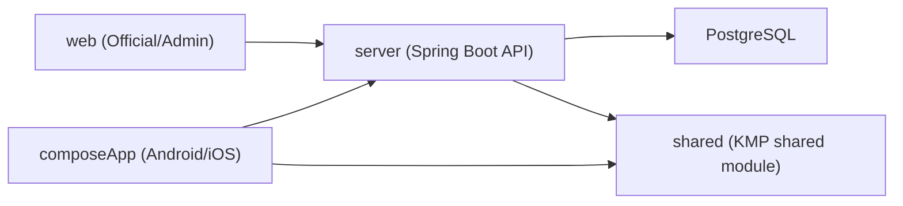

[](https://oguri-kotlin-multiplatform-19hx.onrender.com)

<div align="center">
  <h1> 오구리</h1>
  <p><strong>연차 조합을 추천하고 여행 준비까지 돕는 서비스</strong></p>
  <p>이번엔 이렇게 쉬어볼까요?</p>
</div>

## 오구리

오구리는 연차·주말·공휴일을 조합해 휴가 시기와 여행지를 추천합니다. 추천에서 실제 여행을 만들고, 동행자와 날짜별 장소와 방문 순서를 함께 편집할 수 있습니다.

- 모바일 앱은 Kotlin Multiplatform과 Compose Multiplatform으로 Android·iOS를 지원합니다.
- 서버 API는 Spring Boot, JPA, Flyway, PostgreSQL을 사용합니다.
- 웹은 React/Vite로 공식 사이트(`/`), 어드민(`/admin`), 여행 초대 안내(`/trip-invite/`)를 제공합니다.

## 핵심 기능

- `Home`: 연차 사용 대비 가장 좋은 휴식 조합 추천
- `Calendar`: 카드 기반 추천 일정 탐색 + 무한 스크롤
- `Travel`: 회원 전용 여행 계획, 여러 도시 선택, Google 지도와 장소 검색, 초대와 공동 편집
- `MyPage`: 저장한 일정/여행지 및 연차 설정 관리
- `Admin Web`: 여행지/사용자/공휴일 데이터 관리, 이미지 업로드 및 정리

## 기술 스택

- Kotlin `2.3.0`
- Compose Multiplatform `1.10.0`
- Ktor `3.3.3` (모바일 네트워크 계층)
- Spring Boot `3.4.3` (서버)
- PostgreSQL + Flyway
- React `18` + Vite `6` (웹)
- 앱 버전 `1.3.2`, 빌드 번호 `19` ([version.properties](./version.properties))

## 아키텍처



모바일의 의존성 방향은 `data → domain ← feature/ui`입니다. UI는 공용 `core`를 사용하며, Metro의 `AppGraph`가 도메인 인터페이스에 데이터 구현을 주입합니다.

## 프로젝트 구조

```text
.
├─ composeApp/   # KMP 모바일 앱 (Android/iOS 공용 UI 포함)
├─ iosApp/       # iOS 진입점(Xcode 프로젝트)
├─ server/       # Spring Boot API
├─ web/          # 공식 사이트, 어드민, 초대 안내
├─ shared/       # 공용 Kotlin 모듈
├─ guide/        # 개발·디자인·운영 가이드
└─ plan/         # 여행 플래너 명세와 검증 기록
```

## 문서

- [모바일 구조](guide/MOBILE_PROJECT_STRUCTURE.md), [모바일 컨벤션](guide/MOBILE_CONVENTIONS.md), [서버 개발 가이드](guide/GEMINI.md), [디자인 시스템](guide/DESIGN.md)
- [웹 실행과 배포](web/README.md), [공식 사이트](guide/WEB_OFFICIAL_SITE.md), [어드민 설정](guide/WEB_ADMIN_SETUP.md)
- [여행 명세](plan/TRAVEL_PLANNER_SPEC.md), [화면 디자인](plan/TRAVEL_PLANNER_DESIGN.md), [구현 구조와 API](plan/TRAVEL_PLANNER_IMPLEMENTATION.md)
- [여행 검증과 운영](plan/TRAVEL_PLANNER_TESTING.md), [지표 정의](plan/TRAVEL_PLANNER_METRICS.md), [변경 기록](plan/TRAVEL_PLANNER_PROGRESS.md)

## Contributors
|  |  |
|:---:|:---:|
| [공백(최준서)](https://github.com/junseo511) | [비비(장민정)](https://github.com/rosemin928) |

## Support Oguri
프로젝트가 마음에 드셨다면 이 저장소에 Star(⭐️)를 눌러주세요. 큰 힘이 됩니다.
