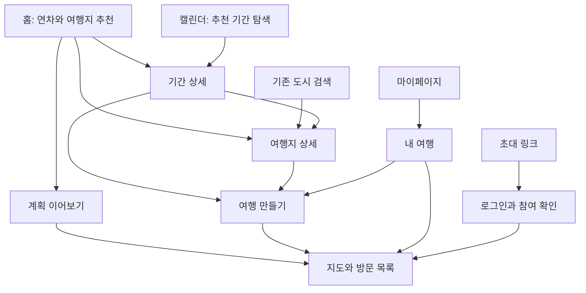

# 여행 계획과 공동 일정 관리 통합 명세

> 버전: 0.3 · 작성·통합일: 2026. 11. 13. · 상태: 제품 기획 제안
>
> 목적: 연차·연휴 추천에서 실제 여행 준비까지 연결하면서, 사용자가 장소와 순서를 편하게 정리할 수 있는 경험을 정의한다.
>
> 확인 범위: 로컬 `develop-mobile` 브랜치의 `9c91736`과 현재 작업본, 프로젝트 가이드, 모바일 화면·내비게이션·디자인 시스템, 서버 도메인, 공식 웹의 참고 이미지. 앱 실행·운영 지표·사용자 실험은 확인하지 않았다. `현재`는 확인한 구현, `제안`은 새 기능의 설계, `가설`은 사용자 검증이 필요한 판단을 뜻한다.
>
> 기존 기획과 별도 점검 내용을 이 문서로 통합했다. 이 문서가 여행 플래너의 기준 명세이며, 요구 기능·사용감·재사용 흐름·인수 기준을 함께 관리한다.

## 1. 제품의 방향

오구리의 연차 전략 추천을 **휴가를 발견하고, 그 휴가에 떠날 여행을 함께 준비하는 경험**으로 확장한다. 추천을 탐색하는 사용자는 기존 흐름을 이용하고, 여행을 결정한 사용자는 구체적인 방문 계획을 만든다.

여기서 가벼운 사용감은 **한 번에 읽을 정보와 판단할 선택이 적고, 하던 일을 자연스럽게 이어갈 수 있는 상태**를 뜻한다. 앱 용량·실행 속도는 별도로 측정할 품질 항목이다.

| 결정 | 최종 제안 |
| --- | --- |
| 앱 구조 | 기존 `홈 / 캘린더 / 마이페이지` 유지. 여행 계획은 상세 화면으로 연결 |
| 시작점 | 여행지·기간 상세에서 선택한 문맥을 이어받아 여행 생성. 내 여행에서 직접 생성도 지원 |
| 중심 화면 | 선택한 날짜의 지도와 방문 목록, `장소 추가`에 집중 |
| 선택 정보 | 시각·메모·멤버·변경 요약·알림은 해당 항목이나 메뉴를 열었을 때 제공 |
| 공동 작업 | 친구와 같은 계획을 수정하고 저장 결과를 공유 |
| 재사용 | 마지막 작업 상태, 부드러운 외부 지도 복귀, 지난 여행에서 다음 휴가 탐색 |

초기 사용자에게 필요한 경험은 **여행을 만들고 → 장소를 담고 → 순서를 바꾸고 → 친구와 함께 수정하는 것**이다. 초대·시각·메모·알림 설정을 순서대로 끝내야 하는 준비 절차는 만들지 않는다.

## 2. 현재 오구리와 연결할 지점

### 2.1 서비스와 UX

| 영역 | 현재 확인한 경험 | 여행 플래너와의 연결 |
| --- | --- | --- |
| 홈 | 연차 대비 좋은 휴가 조합과 해당 시기 여행지 추천 | 기간과 도시를 계획 생성에 전달. 예정 여행이 있으면 작은 이어보기 영역 제공 |
| 캘린더 | 연차·연도·월에 맞는 추천 기간 카드 탐색 | 날짜를 먼저 고른 사용자가 기간 상세에서 여행 생성 |
| 기간 상세 | 휴가 정보와 그 기간에 맞는 도시 목록 | 날짜를 유지한 채 도시 선택 또는 여행 생성 |
| 여행지 상세·검색 | 도시 소개·이미지·여행 정보·체험·항공권·저장·공유, 도시 검색 | 도시를 결정한 시점에 계획 생성. 기존 도시 검색과 방문 장소 검색은 역할 구분 |
| 마이페이지 | 연차 설정, 저장한 휴가 기간과 도시, 계정·문서 관리 | 내가 만들거나 참여한 여행을 다시 찾는 보관 위치 |
| 로그인·공유 | 비회원 탐색, 회원 가입·연차 설정, 도시·기간 딥링크 | 여행 목록·생성·편집·참여는 회원 전용. 로그인·설치 이후 원래 목적지로 복귀 |

현재 저장 휴가 일정에는 기간과 필요 연차가, 저장 여행지에는 도시가 담긴다. 방문 장소·일별 방문 순서·여행 멤버를 관리하는 구조는 확인한 소스 범위에서 찾지 못했다. 북마크와 실제 여행 계획은 구분한다.

현재 메인 탭 이동은 백스택을 초기화하고 상세는 push로 열린다. 여행의 저장과 복귀 문맥은 화면 스택에만 의존하지 않아야 한다.

### 2.2 디자인과 표현

민트·주황과 중립색, Pretendard, 기존 카드·바텀시트·스낵바 체계를 따른다. 제품 문구는 짧은 해요체와 제안형을 사용한다. 디자인 기준은 [DESIGN.md](./DESIGN.md)와 모바일 가이드를 따른다.

공식 웹에 포함된 화면 이미지는 시각적 참고 자료다. 이미지의 날짜·연차 수치와 모든 배치를 최신 실행 화면의 증거로 사용하지 않는다. 타 여행 서비스의 변화와 이용자 이동 규모도 이 문서에서 확인한 사실로 취급하지 않는다.

## 3. 사용감을 가볍게 만드는 표시 원칙

### 3.1 필요한 순간에 정보를 연다

| 정보·기능 | 기본 화면 | 자세한 내용을 여는 순간 |
| --- | --- | --- |
| 여행명·선택 날짜 | 간결하게 표시 | 제목·더보기에서 기본 정보 확인 |
| 지도·방문 순서 | 선택 날짜의 핀과 목록 | 지도 조작, 장소 선택, 목록 확장 |
| 시각 | 사용자가 설정한 값만 표시 | 방문 항목을 눌러 편집 |
| 메모 | 내용이 있을 때만 작은 표시 | 방문 항목을 눌러 읽고 편집 |
| 날짜 없는 장소 | 날짜 선택 영역의 한 항목 | 사용자가 선택하거나 추가 시 날짜 없이 담기 선택 |
| 친구·권한 | 상단 멤버 버튼 | 버튼을 눌러 멤버 확인·초대 |
| 변경 요약 | 제목 아래 보조 수정 시점 문구에 통합 | 수정 시점 또는 더보기의 `최근 변경` 선택 |
| 알림 | 기본 꺼짐. 생성·초대·첫 방문에서 권유하지 않음 | 더보기의 개인 알림 설정 선택 |
| 저장 | 작은 상태 표시 | 실패·충돌이 생겼을 때 필요한 복구 행동 제공 |

수정 시점 문구는 `최근 수정 10분 전`처럼 한 줄로 제공한다. 여행을 보고 있는 동안 숫자를 계속 바꾸거나 강조 애니메이션을 반복하지 않는다. 개인별 미확인 개수를 홈·탭·목록에 배지로 누적하지 않는다.

### 3.2 사용자의 작업을 방해하지 않는다

- 생성 후 바로 장소를 추가할 수 있다. 초대·알림·사용법 안내를 중간에 끼우지 않는다.
- 정상 저장마다 팝업이나 스낵바를 띄우지 않는다. 저장 상태를 가까운 위치에서 조용히 전달한다.
- 다른 사람의 수정이 들어와도 입력 포커스·선택 날짜·지도 시점을 바꾸지 않는다.
- 자동으로 다음 할 일을 제안하는 배너, 준비 단계 체크리스트, 일정 완성률을 제공하지 않는다.
- 빈 날짜를 미완료로 판단하지 않는다. 시각·메모 없이 장소 순서만 정해도 계획이 성립한다.
- 같은 안내를 화면 이동 때마다 반복하지 않는다. 빈 상태에는 첫 장소를 담는 데 필요한 짧은 설명만 둔다.

### 3.3 화면과 조작의 기준

계획 화면의 주요 행동은 `장소 추가`다. 장소의 수정은 행 선택, 순서 변경은 손잡이 조작으로 연결한다. 주요 행동과 같은 크기·색상의 버튼을 여러 개 나란히 두지 않는다.

지도를 보지 않아도 목록에서 같은 작업을 할 수 있어야 한다. 작은 화면·큰 글자·스크린리더에서는 목록 중심으로 이용할 수 있게 한다. 기능을 숨겨 발견하기 어려워지지 않도록 멤버·더보기·장소 편집의 이름과 조작 범위를 명확히 한다.

## 4. 진입 위치와 정보 구조

### 4.1 구조 비교와 선택

| 구조 | 장점 | 주의점 | 선택 |
| --- | --- | --- | --- |
| 기존 화면에 진입점 + 여행 상세 신설 | 추천 맥락과 기존 탭 유지 | 보관 위치와 재진입 경로가 필요 | 채택 |
| 여행 탭 추가 | 반복 접근이 뚜렷함 | 여행이 없는 사용자에게 새 영역을 학습시킴 | 실제 수요 확인 후 검토 |
| 캘린더에 추천·개인 방문 일정 통합 | 날짜 중심으로 모을 수 있음 | 연차 추천과 방문 편집이 섞임 | 초기 제외 |



위 구조는 사용자 관점의 연결이다. 모든 항목을 별도 전체 화면으로 만들라는 구현 지시는 아니다.

### 4.2 진입점과 전달할 정보

| 진입점 | 동작 | 전달할 문맥 |
| --- | --- | --- |
| 여행지 상세 | 여행 정보 다음의 `이 여행 계획하기` | 도시와 함께 전달받은 추천 기간 |
| 기간 상세 | 휴가 요약 아래 `이 기간으로 여행 만들기` | 추천 기간. 도시는 생성 화면에서 선택 가능 |
| 마이페이지 | 프로필 아래 `내 여행`, `전체 보기`와 새 여행 진입 | 내가 만들거나 참여한 여행 |
| 홈 | 예정·진행 중 여행이 있을 때 작은 `계획 이어보기` 한 장 | 여행명·기간과 해당 여행을 여는 행동 |
| 초대 링크 | 유효성 확인 후 명시적으로 참여 | 초대받은 여행 |

홈에서는 최고 연차 전략의 위계를 유지한다. 이어보기에는 다음 행동 제안·미확인 개수·알림 신청 버튼을 더하지 않는다. 여행이 없으면 빈 플래너 카드를 노출하지 않는다. 내 여행 조회 실패도 추천 홈 전체의 실패로 확대하지 않는다.

이어보기 대상은 진행 중 여행을 먼저, 그다음 내가 마지막으로 연 예정 여행을 선택한다. 아직 연 적이 없으면 출발이 가까운 여행을 보여준다. 진행 중 여행이 여러 개면 그중 내가 마지막으로 연 여행을 우선한다. 친구의 잦은 수정만으로 대상이 바뀌지 않는다.

### 4.3 저장한 추천과 실제 여행

- 저장한 휴가 일정은 나중에 검토할 추천 기간이다.
- 담아둔 여행지는 관심 있는 도시다.
- 내 여행은 실제 여행 날짜·방문 계획·멤버를 가진 작업 공간이다.
- 날짜 없는 장소는 특정 여행에 속한 미배정 방문 항목이다.

기존 북마크는 해당 상세를 거쳐 계획으로 이어진다. 여러 북마크를 임의로 조합하지 않는다. 북마크 해제와 여행 삭제는 서로 영향을 주지 않는다. 같은 도시·기간의 여행이 있으면 열어볼 수 있게 안내하되 별도 생성도 허용한다.

## 5. 전체 사용자 흐름과 복귀

### 5.1 첫 계획

1. 추천·저장한 도시 또는 기간에서 계획을 시작하거나 내 여행에서 직접 만든다.
2. 비회원이면 먼저 로그인·필수 가입 절차를 완료한다. 추천 도시·기간과 원래 진입 의도만 유지하며 일정 입력은 제공하지 않는다.
3. 로그인 후 한 화면에서 도시와 실제 여행 시작일·종료일을 확인한다. 제목은 기본값을 사용해도 된다.
4. 여행을 만들면 선택 날짜의 지도와 빈 목록을 바로 연다.
5. 장소를 검색해 날짜에 추가하거나 날짜 없이 담는다.
6. 목록 순서를 바꾸고 필요한 방문에만 시각·메모를 적는다.
7. 함께 준비하고 싶을 때 멤버 버튼에서 친구를 초대한다.

**예시:** 긴 연휴 추천을 보고 오사카를 선택한 사용자가 실제로 여행할 4일을 고른다. 식당과 관광지를 담아 둘째 날에 배정하고 순서를 바꾼다. 친구는 초대에 참여한 뒤 같은 계획에 카페를 추가한다. 다음에 열면 마지막 보던 일차가 유지된다. 장소와 기간은 설명용이다.

### 5.2 진입 의도와 복귀 우선순위

명시적으로 선택한 날짜·목적지를 마지막 보기 상태보다 우선한다. 목적지가 없을 때 마지막 보기 상태를 사용한다.

| 상황 | 도착·복귀 규칙 |
| --- | --- |
| 일반 이어보기 | 마지막으로 보던 날짜. 없거나 유효하지 않으면 여행 전·후에는 1일차, 여행 중에는 현지 오늘 |
| 오늘 날짜 선택 | 여행지 현지 날짜의 일차. 일반 날짜 칩과 같은 조작으로 접근 |
| 최근 변경에서 날짜 선택 | 해당 일차의 현재 계획. 삭제·이동된 대상은 현재 상태 안내 |
| 검색·외부 지도에서 복귀 | 여행·날짜·선택 방문과 가능한 지도·목록 위치 유지 |
| 로그인·온보딩에서 복귀 | 생성·참여·여행 확인 중 원래 의도 복원. 권한과 링크 유효성 재확인 |
| 로그인 취소 | 회원 전용 안내로 복귀하며 추천 도시·기간과 원래 진입 의도 유지. 일정 입력은 열지 않음 |
| 추천 상세에서 연 계획을 닫음 | 원래 도시·기간 상세와 유효한 탐색 문맥으로 복귀 |
| 외부 링크 진입 후 이전 화면이 없음 | 여행에서 뒤로가면 내 여행. 초대·생성 화면을 반복해서 열지 않음 |
| 지난 여행에서 다음 휴가 찾기 | 현재 개인 연차 설정을 사용하는 기존 캘린더로 이동 |

## 6. 화면별 경험

### T01. 내 여행

- 예정·진행 중 여행을 먼저 보여주고 지난 여행은 접힌 영역에 둔다.
- 카드에는 제목·도시·기간과 필요한 멤버 정보를 간결하게 표시한다. 날짜에는 연도를 식별할 수 있어야 한다.
- 카드 전체를 누르면 계획을 연다. 삭제·나가기는 더보기로 구분한다.
- 내가 만든 여행과 참여한 여행을 같은 목록에서 제공한다. 두 역할을 별도 탭으로 나누지 않는다.
- 이미지 선택이나 여행 완료 처리를 필수로 요구하지 않는다. 기본 여행 아이콘으로 시작할 수 있다.
- 여행이 없으면 짧은 빈 상태와 `여행 만들기`를 제공한다. 비회원·빈 목록·불러오기 실패를 구분한다.
- 지난 여행에서는 계획을 그대로 볼 수 있고 `다음 휴가 찾기`로 기존 추천에 연결한다. 새 여행을 만들도록 팝업을 띄우지 않는다.

### T02. 여행 만들기

| 항목 | 규칙 |
| --- | --- |
| 도시 | 기존 추천 도시를 우선 활용. 없는 도시는 Google 도시 검색으로 선택 가능 |
| 날짜 | 실제 시작일·종료일 필수. 추천 기간을 미리 채우되 수정 가능. 당일 여행 허용 |
| 제목 | 도시 기반 기본 제목 제공. 수정은 선택이며 공백만 입력한 제목은 확정하지 않음 |
| 현지 시간대 | 도시 기준으로 설정하고 필요하면 확인·변경. 판별 실패를 기기 시간대로 묵시적으로 대체하지 않음 |
| 연차·멤버·알림 | 생성의 필수 입력에서 제외 |
| 확정 | `여행 만들기`. 중복 탭·응답 재시도로 같은 여행이 여러 개 생기지 않게 함 |

종료일은 시작일보다 빠를 수 없다. 추천 기간이 긴 경우 실제로 떠나는 날짜만 선택할 수 있다. 여행 목록·생성·편집은 회원만 이용한다. 비회원에게는 로그인 안내를 표시하고 도시 검색·날짜 입력을 열지 않는다. 필수 약관을 거친 신규 회원은 기존 연차 설정 건너뛰기를 이용할 수 있어야 한다.

현재 로그인은 홈 또는 온보딩으로 이어진다. 생성·초대 문맥을 보존하고 가입 후 돌아오는 동작은 신규 요구사항이다.

### T03. 지도와 방문 목록

```text
┌──────────────────────────────────┐
│ 뒤로  오사카 여행      멤버  더보기 │
│ 최근 수정 10분 전                 │
├──────────────────────────────────┤
│ 1일차 / 2일차 / … / 날짜 없음     │
├──────────────────────────────────┤
│                                  │
│      ① ···· ② ···· ③            │
│             지도                 │
│               이 날짜 전체 보기  │
├────────── 목록 펼침 손잡이 ───────┤
│ 2일차 · 4월 11일        저장됨    │
│ ① 방문 장소                이동 │
│ ② 방문 장소                이동 │
│ ③ 방문 장소                이동 │
│                                  │
│           + 장소 추가            │
└──────────────────────────────────┘
```

배치 설명용 와이어프레임이다. 날짜·장소 개수·실제 치수는 실행 화면의 증거가 아니다. `이동`은 목록의 순서 변경 손잡이를 뜻한다.

- 지도와 목록을 함께 보는 높이로 진입한다. 손잡이로 목록을 펼치거나 접을 수 있으며 작은 화면·큰 글자는 목록을 우선한다.
- 날짜는 두 영역에 공통으로 적용한다. 지도용·목록용 날짜 필터를 따로 만들지 않는다.
- 목록에는 번호·장소명과 사용자가 설정한 시각을 우선 표시한다. 비어 있는 시간·메모 입력칸을 반복 노출하지 않는다.
- 메모가 있을 때만 작은 표시를 두고 본문은 항목 선택 후 읽는다. 각 행에 삭제·공유·길찾기 버튼을 모두 나열하지 않는다.
- 전체 날짜의 위치를 살피는 기능은 날짜 선택 영역에서 보조 선택으로 제공한다. 전체 보기에서 일차 사이를 선으로 잇지 않는다.
- 날짜 없음은 해당 여행의 장소만 보여준다. 핀에는 방문 순서 번호·연결선을 표시하지 않는다.
- 수정 시점 문구를 누르면 최근 변경을 열 수 있다. 자동 변경 요약 팝업·다음 행동 배너·미확인 개수 배지는 두지 않는다.
- 편집 화면에는 메인 하단 탭을 표시하지 않는다. 검색·지도·초대에서 돌아와도 보던 날짜가 유지된다.

### T04. 장소 검색과 추가

1. `장소 추가`를 누르면 여행·선택 날짜를 유지한 검색을 연다.
2. 여행 도시 또는 현재 지도 영역을 우선 기준으로 검색한다. 기기 위치 권한을 필수로 요구하지 않는다.
3. 결과의 이름과 주소·지역을 함께 보여 동명 장소를 구별한다. 선택한 결과는 지도에서 위치를 확인할 수 있다.
4. `2일차에 추가`처럼 대상을 밝힌 버튼을 제공한다. 날짜가 미정이면 보조 선택인 `날짜 없이 담기`를 이용한다.
5. 추가 결과가 저장되면 결과 행에 반영하고 계속 검색할 수 있게 한다. 닫으면 보던 날짜로 돌아온다.

| 상황 | 규칙 |
| --- | --- |
| 날짜에 추가 | 맨 뒤에 배치. 추가할 때마다 방문 시각·메모 입력을 요구하지 않음 |
| 전체 보기에서 추가 | 날짜 선택 또는 날짜 없이 담기. 임의 일차에 넣지 않음 |
| 같은 날 이미 있는 장소 | 기존 항목 열기를 우선 제공. 재방문을 원하면 별도 방문으로 다시 추가 가능 |
| 다른 날짜에도 있는 장소 | 별도 방문으로 추가. 기존 항목을 자동 이동시키지 않음 |
| 검색되지 않는 장소 | 직접 추가로 제목·메모 기록. 위치 지정은 선택 |
| 검색 실패 | 결과 없음과 구분. 기존 일정은 유지하고 재시도·직접 추가 제공 |

리뷰·사진·평점·영업시간을 결과마다 펼쳐 보여주지 않는다. MVP의 검색은 장소를 찾고 추가하는 데 집중하고, 더 자세한 정보는 외부 지도에서 확인할 수 있다.

### T05. 방문 항목 편집

장소 행을 누르면 시각·메모·날짜 이동을 편집하는 시트를 연다. 삭제와 외부 길찾기는 이 항목의 보조 행동으로 둔다.

| 행동 | 규칙 |
| --- | --- |
| 시각·메모 | 선택 입력. 편집 시트의 `적용`으로 함께 확정. 메모는 멤버 전체에게 보임을 설명 |
| 날짜 이동 | 목적 날짜의 맨 뒤로 이동. 날짜 없음으로 되돌리기 가능 |
| 순서 변경 | 손잡이 드래그. 메뉴의 위로·아래로도 같은 결과 제공 |
| 직접 추가 장소 수정 | 사용자가 쓴 제목·위치 수정. 외부 장소의 공식 정보 변경과 구분 |
| 삭제 | 해당 방문만 삭제. 같은 장소의 다른 방문 유지 |
| 되돌리기 | 방금 수행한 본인의 삭제·이동에 제공. 타인의 후속 변경을 덮어쓰지 않음 |

시각만 입력했다고 자동 정렬하지 않는다. 순서와 시각이 어긋나면 해당 편집 맥락에서만 확인할 수 있게 안내하며 전체 화면 경고로 확대하지 않는다. 체류시간 자동 계산·예약 고정·자정을 넘는 교통편은 이후 확장이다.

### T06. 멤버와 초대

- 상단 멤버 버튼에서 참여자를 확인하고 소유자는 초대 링크를 공유한다. 생성 직후 초대를 강제하지 않는다.
- 공유 전에 링크를 받은 사람이 로그인·참여하면 수정할 수 있다는 점을 알린다.
- 초대받은 사람은 여행 제목·기간·초대한 사람을 확인하고 `함께 계획하기`를 선택한다. 링크 열기만으로 참여시키지 않는다.
- 비회원은 로그인·필수 가입 절차 후 같은 참여 화면으로 돌아온다. 기존 멤버는 중복 참여 없이 계획을 연다.
- 앱 미설치 시 초대 안내와 설치 경로를 제공한다. 자동 복귀가 어려우면 원래 공유 메시지의 같은 링크를 다시 열어 참여할 수 있게 안내한다.
- 만료·철회·삭제·권한 없음은 이유와 다음 행동을 구분한다. 일별 일정과 메모는 참여 권한 확인 후에 노출한다.

### T07. 여행 더보기

기본 정보 수정, 최근 변경, 내 알림, 나가기·삭제처럼 자주 쓰지 않는 행동을 모은다. 개인 설정과 여행 전체에 영향을 주는 설정을 구분하고 권한에 맞는 항목만 보여준다.

제목·도시·기간 수정에는 기존 계획에 미칠 영향을 보여준다. 위험한 전체 삭제는 별도 확인하고, 일반적인 장소 편집마다 확인 팝업을 띄우지 않는다. 알림은 사용자가 이 메뉴에서 직접 선택할 때만 설정한다.

## 7. 지도·목록·제스처의 연결

### 7.1 같은 방문을 선택한다

목록 행과 핀은 같은 방문 항목을 가리킨다. 같은 장소를 여러 번 방문해도 방문별로 구분한다.

- 행을 선택하면 해당 핀을 강조하고 보이는 위치로 이동한다.
- 핀을 선택하면 해당 행을 강조하고 보이도록 이동한다. 필요할 때 사용자가 행을 눌러 편집 시트를 연다.
- 단순 목록 스크롤에는 지도를 이동시키지 않는다. 직접 움직인 지도는 `이 날짜 전체 보기`로 다시 맞춘다.
- 겹친 핀은 확대 또는 선택 목록으로 각각 접근할 수 있어야 한다.

### 7.2 방문 순서를 표시한다

일별 목록 순서를 핀 번호와 연결선에 함께 반영한다. 드래그 중에는 예상 위치를 보여주고 손을 놓으면 번호·선도 갱신한다. 저장 확정 여부는 별도 상태로 표현한다.

연결선은 방문 순서를 보여준다. 실제 도로 경로·이동시간과 구분할 수 있도록 짧은 범례를 제공한다. 장소가 하나면 핀만, 없으면 도시 중심과 빈 목록을 보여준다. 좌표 없는 방문은 목록에 남기고 관련 선은 끊는다. 앞뒤 장소를 바로 이어 해당 방문을 건너뛴 것처럼 보이게 하지 않는다.

전체 날짜 보기에서는 날짜 라벨과 색·형태를 함께 사용한다. 색만으로 구별하거나 모든 날짜의 선을 한 경로처럼 연결하지 않는다.

### 7.3 조작과 외부 길찾기

목록 손잡이에서 시작한 조작은 재정렬, 목록 본문은 스크롤, 시트 손잡이는 펼침·접힘, 지도 영역은 지도 조작으로 구분한다. 드래그 없이도 순서 변경·날짜 이동이 가능해야 한다. 플랫폼 뒤로가기·스크린리더·글자 확대와 충돌하는지 실제 기기에서 확인한다.

항목 또는 인접 두 장소에서 `Google Maps에서 길찾기`를 제공한다. 앱으로 열 수 없으면 웹을 사용하고 복귀 시 같은 계획을 유지한다. 외부 지도 사용만으로 방문 완료나 예약 완료를 표시하지 않는다. [Maps URLs](https://developers.google.com/maps/documentation/urls/get-started)는 외부 연결의 근거이며 앱 내 지도·검색과 적용 조건을 따로 확인한다.

## 8. 공동 편집과 권한

### 8.1 역할

| 행동 | 소유자 | 참여 멤버 |
| --- | --- | --- |
| 계획 조회, 방문 추가·삭제·시각·메모·날짜·순서 편집 | 가능 | 가능 |
| 다른 멤버가 추가한 방문 편집 | 가능 | 가능 |
| 여행 제목·도시·기간 변경, 초대 발급·철회, 멤버 제외 | 가능 | 불가 |
| 여행 삭제·소유권 이전 | 가능 | 불가 |
| 나가기 | 소유권 처리 후 가능 | 가능 |

미참여자에게는 제한된 초대 안내만 제공한다. 개인 남은 연차·선호 연차는 여행 멤버에게 기본 공개하지 않는다. 읽기 전용 공유·제안 승인·세부 역할은 후속 범위다.

### 8.2 초대와 접근 종료

여행은 기본 비공개다. 초대 수단은 추측하기 어렵게 만들고 참여·저장·조회 시 계정 권한을 확인한다. 초기 링크 유효 기간은 발급 후 7일을 제안하며 소유자는 철회·재발급할 수 있다.

링크 철회는 새 참여를 막고, 기존 멤버 제외는 별도 행동이다. 제외한 멤버가 같은 링크로 즉시 복귀하지 못하도록 기존 링크도 무효화한다. 나간 사람이 기여한 공동 계획은 유지되며 나가기 전에 이를 설명한다.

소유자가 나가려면 다른 참여자가 소유권 이전을 수락하거나 여행을 삭제한다. 계정 탈퇴에도 소유자 없는 여행이 남지 않아야 한다. 탈퇴 후 공동 기록의 계정 식별 정보·이름 처리와 보관 정책은 출시 전에 확정한다.

### 8.3 변경 반영과 충돌

온라인에서는 저장된 타인의 변경이 자동 반영되어야 한다. 백그라운드 복귀·재연결 시 최신 내용을 확인한다. 자동 반영을 위해 현재 입력·선택 날짜·지도 시점을 강제로 바꾸지 않는다. 통신·동기화 기술은 확정하지 않는다.

| 동시 상황 | 보장할 결과 |
| --- | --- |
| 서로 다른 항목 추가·독립된 수정 | 둘 다 보존. 같은 삽입 위치는 저장 확정 순서 등 일관된 순서로 공유 |
| 같은 메모·같은 날짜 순서 수정 | 오래된 전체 내용으로 덮어쓰지 않음. 최신 내용과 나의 미적용 입력을 구분해 재적용 가능 |
| 삭제된 방문을 다른 사람이 수정 | 삭제 유지. 입력은 보존하고 자동 부활·복제 방지 |
| 날짜 이동·기간 변경과 편집이 겹침 | 부분 적용으로 항목 유실·중복이 생기지 않게 함. 충돌하면 최신 내용으로 다시 확인 |
| 저장 중 멤버 제외·여행 삭제 | 최신 권한·상태 확인 후 거절. 확인된 접근 종료는 화면과 기기 내 데이터에도 반영 |

### 8.4 사용자가 여는 최근 변경

수정 시점 문구나 더보기의 `최근 변경`을 선택하면 마지막 확인 이후 다른 멤버의 변경을 날짜별로 묶어 보여준다. 예를 들어 장소 추가·삭제·순서 변경·기간 변경을 구분한다.

변경한 날짜를 누르면 그날의 현재 계획을 연다. 항목이 삭제되거나 다른 날로 옮겨졌으면 현재 상태를 설명한다. 확인한 범위까지만 내부적으로 반영하고 읽는 동안 들어온 새 변경은 유지한다. 사용자가 직접 읽음 처리 버튼을 누르거나 요약을 모두 확인해야 편집할 수 있는 절차는 두지 않는다.

이 요약은 전체 활동 이력·임의 시점 복원과 구분한다. 삭제된 외부 장소 정보를 이력에 무기한 복제하지 않는다.

## 9. 날짜·현지 시각·연차

추천 기간은 쉴 수 있는 후보 기간이고 여행 날짜는 실제로 떠날 기간이다. 추천 중 일부 날짜만 고르거나 필요하면 범위 밖으로 바꿀 수 있다. 출처 추천은 보관하되 추천 순위 변화가 여행을 자동 변경하지 않게 한다.

| 변경 | 처리 |
| --- | --- |
| 시작일 이동 | 일차별 배치를 기본으로 날짜 이동. 기존 방문 순서·시각·메모 유지 |
| 기간 연장 | 늘어난 일차를 빈 일정으로 추가 |
| 기간 단축 | 영향을 미리 보여주고 범위 밖 방문은 삭제 없이 날짜 없음으로 이동 |
| 도시 변경 | 기존 방문을 삭제·치환하지 않음. 지도 기준과 시간대 영향을 확인 |
| 시간대 변경 | 입력한 현지 시각을 유지하는 안을 기본으로 설명하고 확인. 묵시적 변환 금지 |

방문 시각은 여행의 기준 도시 현지 시각이다. 다른 나라에 있는 동행자도 같은 시각을 본다. 카드에는 일차와 실제 날짜를 함께 표시한다. 한 여행의 기준 도시·시간대는 하나로 시작하며 근교 장소는 추가할 수 있다.

연차 원본 정보는 출처로 구분해 필요할 때 기본 정보에서 확인한다. 추천 전체 기간의 휴식·연차 수치를 짧게 고른 여행의 결과처럼 표시하지 않는다. 여행 생성·참여가 개인 남은 연차를 자동 차감하지도 않는다.

현재 저장 기간의 연차 계산은 주말과 등록 공휴일을 제외한다. 교대근무·개인 휴무·회사 지정 휴일을 반영한다고 설명하지 않는다. 개인화된 연차 비교와 다도시·다시간대 교통편은 후속 검증 대상이다.

## 10. 저장과 예외 상황

### 10.1 평소에는 조용히 저장한다

추가·삭제·재정렬·날짜 이동은 완료 행동마다 저장하고 시각·메모는 편집 시트의 `적용`으로 확정한다. 작은 상태 영역에 저장 중·저장됨·미저장을 구분하며 서버 확인 전에 저장됨으로 표시하지 않는다.

생성·방문 추가는 재시도해도 같은 요청이 복제되지 않아야 한다. 정상 저장 후 앱 종료·재실행·다른 기기에서도 계획을 유지한다. 개인별 보기 상태는 공동 방문 순서와 분리한다.

### 10.2 도움이 필요할 때만 개입한다

| 상황 | 사용자 경험 |
| --- | --- |
| 빈 날짜 | 해당 날짜가 비어 있음을 간단히 표시. 미완료 경고·초대·알림 신청을 함께 띄우지 않음 |
| 검색·지도 장애 | 가능한 목록·메모·편집 유지. 실패한 영역만 재시도 |
| 저장 실패 | `저장하지 못했어요. 다시 시도해 주세요.`와 재시도. 확정 상태와 남은 입력 구분 |
| 공동 편집 충돌 | 해당 편집에 최신 내용과 미적용 입력 제공. 다른 화면까지 경고 확대 금지 |
| 미적용 입력이 있는 채 나가기 | 계속 작성 또는 나가기 선택. 보존·포기되는 내용을 명시 |
| 인증 만료 | 입력 보존 후 로그인. 원래 여행으로 돌아와 권한 재확인 |
| 삭제·접근 종료 | 이유를 안내하고 내 여행으로 이동. 종료가 확인된 내용을 계속 노출하지 않음 |
| 장소 정보 조회 실패·폐업 | 사용자 작성 방문·시각·메모 유지. 다시 연결하거나 직접 작성한 제목으로 확인 |

### 10.3 연결이 끊겼을 때

MVP는 온라인 편집을 기준으로 한다. 연결이 끊기면 마지막 확인한 사용자 작성 계획을 허용된 범위에서 보여주고 구조 변경의 신규 확정은 멈춘다. 중단된 입력·미전송 요청은 계정 범위의 초안으로 보존한다.

재실행·재연결 시 최신 상태와 권한을 확인한 뒤 재시도한다. 오래된 초안을 무조건 덮어쓰지 않는다. 로그아웃 또는 접근 종료가 확인되면 해당 계정·여행의 데이터와 초안을 정리한다.

오프라인에서는 권한 변경을 즉시 알 수 없다. 보관 기간·재인증 조건은 출시 전에 정한다. 지도 타일·공급자 응답 전체의 오프라인 보관은 약속하지 않는다.

## 11. 편하게 다시 사용하는 경험과 리텐션

### 11.1 재사용 이유를 작업 안에 둔다

| 사용자의 상황 | 바로 얻는 가치 | 화면의 태도 |
| --- | --- | --- |
| 새로 가고 싶은 곳을 찾음 | 만들어둔 여행에 추가 | 이어보기로 같은 계획을 바로 열기 |
| 며칠 뒤 다시 준비함 | 마지막 보던 일차·위치 유지 | 다음 할 일을 자동 제안하지 않기 |
| 친구의 수정이 궁금함 | 수정 시점과 날짜별 변경 확인 | 사용자가 요약을 열 때만 자세히 표시 |
| 여행 중 동선이 필요함 | 오늘 날짜와 방문 순서·메모 | 기존 날짜 선택으로 접근, 외부 길찾기 복귀 유지 |
| 여행이 끝남 | 지난 계획 보관과 다음 휴가 탐색 | 지난 여행에서 사용자가 원할 때 기존 캘린더로 연결 |

재사용을 위해 장소 수·시각·메모 입력을 늘리도록 유도하지 않는다. 사용자가 필요한 계획을 빠르게 끝내는 것도 성공으로 본다. 여행 준비의 반복 사용과 다음 여행 때의 재사용을 구분하며 실제 개선 효과는 아직 알 수 없다.

### 11.2 본인이 선택하는 출발 전 알림

출발 전 확인 알림은 더보기의 개인 설정으로 둔다. 기본은 꺼짐이며 생성·초대·편집 완료 시 자동으로 신청을 제안하지 않는다. 거절하거나 사용하지 않아도 모든 계획 기능이 동일하게 동작한다.

- 멤버 본인이 미래 날짜·시각과 수신 시간대를 확인하고 예약한다. 소유자가 다른 사람의 알림을 켤 수 없다.
- 용도를 이해하고 신청한 문맥에서만 OS 권한을 요청한다. 거절 후 반복 팝업을 띄우지 않는다.
- 확인한 예약당 한 번만 보내고 열지 않았다고 독촉하지 않는다. 잠금 화면에는 정확한 일정·여행 제목·멤버·메모를 기본 노출하지 않는다.
- 기간 변경 시 이전 예약을 취소하고 새 시각을 본인이 재확인한다. 나가기·제외·삭제·해제도 미발송 예약 취소로 연결한다.
- 로그아웃·계정 변경 시 그 기기의 전달 연결을 해제한다. 이미 전달된 알림은 가능한 범위에서 정리한다.
- 발송 전 현재 권한·여행·설정·예약 버전을 확인한다. 알림을 열 때도 다시 확인하고 유효하면 해당 계획을 연다.

현재 여행용 OS 알림 기능은 확인하지 못했다. 기존 iOS 브리지의 이벤트 전달을 사용자 알림 인프라로 간주하지 않는다. 알림을 핵심 재방문 경로로 가정하지 않으며, 양 플랫폼의 전달·취소·시간대 검증을 별도로 한다.

## 12. MVP와 확장

### 12.1 공개 MVP

| 묶음 | 범위와 표시 원칙 |
| --- | --- |
| 생성·연결 | 추천 문맥 전달, 도시·날짜·기본 제목, 직접 생성, 로그인 복귀 |
| 보관·재진입 | 내 여행, 작은 홈 이어보기, 지난 여행과 다음 휴가 연결 |
| 장소·지도 | 검색·직접 추가·날짜 없이 담기, 일별 핀·순서 연결선, 외부 길찾기 |
| 편집 | 드래그·대체 순서 조작, 날짜 이동·삭제, 항목을 눌러 선택 시각·메모 편집 |
| 협업 | 초대·참여, 두 역할, 온라인 변경 반영·충돌 보존, 사용자가 여는 최근 변경 |
| 관리 | 더보기에서 제목·도시·기간·멤버·소유권·삭제·나가기 관리 |
| 개인 선택 | 더보기에서 본인이 예약하는 1회 알림. 기본 꺼짐, 반복 제안 없음 |
| 기본 품질 | 저장·복귀·실패 복구, 권한 확인, 접근성, 기존 테마·다국어 체계 |

장소·여행 길이·참여 인원 상한은 베타의 실제 비용·성능으로 결정하고 필요한 행동 전에 안내한다. 자동 다음 행동 안내·완성률·미확인 개수 배지는 공개 MVP의 화면에 넣지 않는다.

### 12.2 사용 수요를 확인한 뒤 확장

| 후보 | 먼저 확인할 근거 |
| --- | --- |
| 이동시간·교통수단별 경로·체류시간 | 도시별 지원·정확도, 실제 사용, 비용 |
| 읽기 전용 공유·댓글·투표·전체 이력 | 현재 공동 계획에서 합의가 막히는 지점 |
| 선택형 공동 편집 푸시 | 앱 내 변경 확인만으로 부족한 사례, 과도한 알림의 영향 |
| 개인 연차 비교·날짜 제안 | 근무·공휴일 계산 기준과 신뢰성 |
| 다도시·다시간대·예약 고정·오프라인 강화 | 현재 모델로 해결되지 않는 실제 여행과 정보 보관 권한 |
| 자동 동선·일정 초안 | 제안 품질, 사용자가 수정하기 쉬운가 |
| 별도 여행 탭 | 반복 수요와 현 진입 경로의 실제 탐색 비용 |

개인 여행의 생성·편집·저장 사이클을 먼저 검증하고, 공동 여행의 초대·동시 편집·권한을 연결한다. 공개 MVP는 공동 편집까지 포함한다. 개발 기술·일정·인력은 후속 검토에서 정하며, 사용감 검증은 기능 수를 줄이는 판단과 별도로 한다.

## 13. 구현·운영에서 지킬 경계

### 13.1 지도와 장소 정보

지도 표시·장소 검색·방문 순서 표시·실제 경로 계산을 구분한다. 특정 KMP 라이브러리나 SDK 통합 방식은 확정하지 않는다. Android·iOS의 지도·목록·시트·제스처가 자연스럽게 연결되는지 확인한다.

출시 도시의 검색 품질·언어·위치 정확도·외부 길찾기는 실제 요청으로 검증한다. 국내를 포함해 지역·교통수단별 지원을 과거 지식으로 단정하지 않는다.

Places의 출처 표기·저장 제한을 적용한다. 장소 ID와 사용자 작성 제목·시각·메모·순서는 공급자 정보와 구분하고, 응답 전체를 영구 복제하지 않는다. 지도 위 결과와 목록 단독 표시에는 각각 맞는 표시 조건을 적용한다. 조회 실패 시 사용자 제목이 없다면 `방문 장소 2` 같은 중립 표시를 사용할 수 있다.

### 13.2 비용·개인정보·광고

- 지도·검색·상세·향후 경로·동기화·변경 요약·알림의 사용량을 나누어 확인한다. 현재 요청량과 적용 단가를 몰라 월 비용은 알 수 없다.
- 필요한 필드만 요청하고 입력 중 중복·오래된 검색을 줄인다. 사용량 제한과 비용 알림을 함께 둔다. 예산 알림만으로 과금이 중단되는 것으로 간주하지 않는다.
- 검색 한도·지도 장애가 사용자 작성 계획 전체의 유실이나 저장 중단으로 번지지 않게 한다.
- API 키 용도를 제한하고 메모·여행 제목·검색 원문·초대 비밀값·개인 연차 잔여량을 기본 분석 속성으로 넣지 않는다.
- 기존 세션 리플레이의 일정·메모·초대 화면 제외 또는 마스킹을 확인한다.
- 플래너·초대·로그인 복귀에는 작업을 끊는 광고를 넣지 않는다. 기존 공통 화면 전환 광고 로직에 새 화면을 그대로 포함하지 않는다.

### 13.3 역할과 상태의 책임

여행 계획은 기간·멤버 권한·변경 일관성을, 일별 일정은 배정·이동·순서를, 방문 항목은 방문 의도·선택 정보를 맡는다. 초대는 참여 조건·유효성·철회를 판단한다. 장소 탐색은 공급자 정보를 전달하며 여행 소유권과 방문 순서를 결정하지 않는다.

모바일은 `data → domain ← ui`를 유지한다. UI는 domain에 행동을 요청하고 domain은 지도 SDK·UI·저장 구현에 의존하지 않는다. 지도와 목록은 같은 상태를 보고 사용자 입력은 한 방향으로 처리한다.

검색은 새 입력이 오면 오래된 요청·결과를 취소한다. 동기화 관찰은 화면·계정·권한의 생명주기에 맞춰 끝낸다. 합쳐도 되는 보기 상태와 유실되면 안 되는 편집 명령을 구분한다.

현재 서버 가이드는 layered 구조와 JPA Entity를 사용한다. 이 기획을 이유로 서버 전체의 아키텍처 전환을 요구하지 않는다. 순수 domain 분리가 필요한 충돌이 드러나면 구체적인 영향과 대안을 후속 기술 설계에서 비교한다.

## 14. 효과와 사용감의 검증

### 14.1 사용자 과업

설명 없이 첫 장소 추가를 찾는지, 목록과 지도의 같은 방문을 알아보는지, 시간·메모·초대 없이도 필요한 계획을 끝낼 수 있는지 관찰한다. 멤버·변경 요약을 숨겼다는 이유로 찾지 못하는지도 확인한다.

친구와 실제로 준비하는 상황에서 일정 순서·날짜 변경·충돌을 이해하는지, 검색·외부 지도·로그인에서 돌아와 같은 작업을 이어가는지 확인한다. 정상 사용 중 팝업·안내가 얼마나 끼어드는지도 함께 기록한다. 문서 검토를 실제 사용자 검증 결과로 기록하지 않는다.

### 14.2 핵심 지표

| 지표 | 정의와 해석 |
| --- | --- |
| 추천에서 생성 | 계획 진입 노출·클릭·저장 성공을 구분. 진입원·회원 여부별 관찰 |
| 첫 계획 활성화 | 방문 하나 이상을 날짜에 배정해 저장. 시각·메모·재정렬을 추가 조건으로 요구하지 않음 |
| 준비 기간 재사용 | 다른 세션에서 날짜·핀·변경을 확인하거나 길찾기를 열거나 실제 편집을 저장. 앱 진입·알림 클릭만으로 집계하지 않음 |
| 협업 가치 | 다른 멤버 참여 후 편집 저장, 변경 확인과 후속 행동. 링크 공유만으로 성공 처리하지 않음 |
| 다음 여행 재사용 | 지난 여행 이후 기존 추천 탐색과 새 여행 생성·참여를 분리 |
| 사용감·신뢰 | 과업 완료, 길을 잃은 지점, 불필요한 팝업·조작, 저장 실패·충돌 복구·알림 해제·민원 |

재사용은 사용자-여행 단위와 앱 전체 사용자 단위를 구분한다. 조작 없이 목록을 읽는 가치도 있으므로 실제 계획이 표시된 재방문을 보조 지표로 함께 본다. 편집 횟수·체류시간 증가만으로 좋은 경험이라 판단하지 않는다.

베타의 초기 관찰 창은 다음과 같이 제안한다.

- 시작은 소유자의 생성 성공, 멤버의 첫 참여 성공이다. 같은 사용자-여행을 중복 집계하지 않는다.
- 관찰 대상은 시작 당시 출발까지 8일 이상 남고 관찰 7일이 끝난 집단이다.
- 준비 기간 재사용은 시작 후 24시간부터 7일 이내의 목적 있는 재사용을 본다.
- 임박 여행·여행 중 참여·과거 여행 등록은 별도 집단으로 본다. 나가기·취소·날짜 변경 사례를 유리한 분모를 만들기 위해 빼지 않는다.
- 다음 여행은 관찰 기간의 첫 종료 여행을 기준으로 사용자별 90일을 본다. 관찰이 덜 끝난 사용자는 실패로 확정하지 않고 관찰 중으로 구분한다.

기간값은 제품 가설이며 실제 사용 간격으로 보정한다. 비교의 기간·분모·목표·표본은 실험 전에 정한다. 알림 신청자의 적극성을 알림의 효과로 단정하지 않고, 발송 접수와 실제 기기 표시도 구분한다. 현재 실제 리텐션 상승 폭은 알 수 없다.

## 15. 요구 충족과 시나리오 점검

### 15.1 최초 요청 대조

| 요청한 핵심 경험 | 반영 위치 | 판정 |
| --- | --- | --- |
| 여행지·날짜로 여행 생성 | T02, 4~5장 | MVP 명세 포함 |
| Google 지도·장소 검색·핀·순서 선 | T03~04, 7장 | MVP 명세 포함. 실제 교통 경로 계산은 후속 |
| 장소 추가·삭제·드래그와 지도 반영 | T04~05, 7장 | MVP 명세 포함 |
| 날짜별 장소·선택 시각·메모 | T03~05, 9장 | MVP 명세 포함 |
| 친구 초대·같은 계획 공동 수정 | T06, 8장 | MVP 명세 포함 |
| 연차·연휴 추천과 실제 준비 연결 | 2·4~5·9·11장 | MVP 명세 포함 |

### 15.2 인수 기준

아래는 통합 명세의 확인 사례다. 현재는 기획에 경로와 규칙을 정의한 상태이며, 구현·실험을 통과했다는 뜻이 아니다.

| ID | 상황 | 확인할 결과 |
| --- | --- | --- |
| AC01 | 기간이 있는 도시·기간 상세에서 시작 | 선택 문맥을 이어받고 실제 여행 날짜 수정 가능 |
| AC02 | 비회원의 여행 진입·로그인·가입·취소 | 비회원에게 일정 목록·입력·편집을 제공하지 않음. 로그인 후 추천 문맥과 원래 목적지 복원, 취소 시 접근 차단 유지. 재시도로 중복 여행 생성 방지 |
| AC03 | 추천 밖의 도시·당일 여행 직접 생성 | 추천 탐색 없이 도시·날짜로 생성 가능 |
| AC04 | 첫 계획 생성·첫 장소 추가 | 초대·알림·사용법 팝업 없이 바로 검색·추가 가능 |
| AC05 | 날짜 없이 담은 장소 배정·이동·삭제 | 해당 일차·미배정 영역·지도 일관성 유지. 다른 방문 보존 |
| AC06 | 장소 순서 드래그·대체 조작 | 목록·핀 번호·연결선이 함께 변경. 시각만으로 자동 재정렬하지 않음 |
| AC07 | 지도·목록 선택·스크롤·시트 조작 | 같은 방문 선택. 단순 스크롤·타인 변경으로 지도·포커스를 빼앗지 않음 |
| AC08 | 한 장소, 시각·메모 없음, 빈 날짜 | 유효한 계획으로 저장. 미완료 경고·완성률·다음 행동 배너 없음 |
| AC09 | 시각·공유 메모·직접 추가 장소 수정 | 항목 선택 시에만 필요한 편집 제공. 저장과 공유 범위 이해 가능 |
| AC10 | 친구 초대·설치·로그인·참여 | 자동 복귀 또는 같은 링크 재열기로 해당 참여 화면 도달. 명시적 참여 후 같은 계획 편집 |
| AC11 | 동시 메모·순서·날짜·기간 변경 | 조용한 덮어쓰기·유실·복제 방지. 최신 내용과 나의 입력 구분 |
| AC12 | 며칠 뒤 재방문·최근 변경 확인 | 일반 진입은 보기 상태 복원. 요약은 사용자가 열 때 표시. 확인을 강요하지 않음 |
| AC13 | 여행 여러 개와 친구의 잦은 편집 | 홈 이어보기 대상이 정해진 기준으로 안정적이며 목록에서 모두 접근 가능 |
| AC14 | 기간 단축·도시·시간대 변경 | 영향 미리보기, 범위 밖 장소 보존, 현지 시각과 개인 연차 비공개 유지 |
| AC15 | 검색·외부 지도·추천 상세 복귀 | 여행·날짜·선택 방문과 원래 상세 문맥 유지 |
| AC16 | 저장 실패·연결 끊김·앱 재실행 | 확정 상태와 초안 구분. 입력 복구 후 최신 권한 확인·재시도 |
| AC17 | 초대 철회·멤버 제외·여행 삭제·탈퇴 | 접근 종료와 기기 데이터 처리, 초대 재참여 차단, 소유권 처리 |
| AC18 | 지도·검색·외부 장소 정보 장애 | 사용자 작성 방문·시각·메모와 가능한 목록 편집 유지 |
| AC19 | 큰 글자·스크린리더·드래그 없이 조작 | 목록만으로 조회·편집·날짜·순서 변경 가능. 주요 행동 접근 가능 |
| AC20 | 알림 미신청·거절·해제·예약 변경 | 기본 기능 동일. 반복 권유 없음. 취소 후 과거 예약의 새 발송 차단. 이미 전달된 알림은 최신 상태 확인 |
| AC21 | 지난 여행에서 다음 휴가 찾기 | 기존 계획 유지, 현재 연차 설정의 추천으로 연결, 새 여행 생성 가능 |
| AC22 | 정상 편집·초대·로그인·재방문 | 반복 성공 팝업·작업을 끊는 광고·자동 다음 할 일 제안 없음 |

### 15.3 가벼운 사용감의 최종 확인

기능 접근성과 조용한 화면을 함께 확인한다. 장소 추가를 찾기 어렵거나 멤버·최근 변경이 어디 있는지 알 수 없으면 표시 방식을 보완한다. 반대로 사용자가 요청하지 않은 안내가 반복해서 끼어들면 해당 제안을 제거하거나 선택 시점으로 옮긴다.

요구한 핵심 기능을 유지했고, 별도 점검에서 발견한 복귀·협업·재사용 문제를 이 문서의 화면 규칙과 확인 사례에 반영했다. 사용감의 실제 판정은 사용자 과업과 기기 검증으로 확인한다.

## 16. 출시 전에 확정할 사항

| 항목 | 남은 확인 |
| --- | --- |
| 도시·지도 품질 | 출시 대상과 언어·위치·검색·길찾기의 실제 지원 |
| 동기화·운영 한도 | 허용 가능한 반영 지연, 동시 인원·장소·여행 길이와 비용 |
| 초대 복귀 | 양 플랫폼·설치 경로별 참여 문맥 복원과 재열기 대안 |
| 개인정보·기기 보관 | 계정 탈퇴 후 공동 기록, 오프라인 접근, 보관 기간·재인증·로그아웃 정리 |
| 개인 알림 | 기본 꺼짐과 선택 경로, 권한·취소·전달·예약 시간대, 중복 방지 |
| 사용자 경험 | 지도·시트·목록 제스처, 주요 행동 발견성, 숨긴 기능의 접근성 |
| 성능·효과 | 앱 크기·시작 속도·목록과 지도 반응, 과업 완료와 실제 재사용. 현재 실측 없음 |

이 항목들의 수치·지원 범위·비용은 아직 알 수 없다. 검증 전 성능이나 리텐션 효과를 보장하지 않는다.

## 17. 근거 자료

### 내부 문서·소스

- [MVP_WIREFRAME.md](./MVP_WIREFRAME.md), [DESIGN.md](./DESIGN.md): 현재 서비스와 디자인 기준.
- [MOBILE_PROJECT_STRUCTURE.md](./MOBILE_PROJECT_STRUCTURE.md), [MOBILE_CONVENTIONS.md](./MOBILE_CONVENTIONS.md), [MOBILE_CODE_STYLE.md](./MOBILE_CODE_STYLE.md), [GEMINI.md](./GEMINI.md): 모바일·서버의 책임과 품질 기준.
- [RouteModels.kt](../composeApp/src/commonMain/kotlin/com/bigong/oguri/core/navigation/RouteModels.kt), [MainNavigator.kt](../composeApp/src/commonMain/kotlin/com/bigong/oguri/core/navigation/MainNavigator.kt), [MainNavHost.kt](../composeApp/src/commonMain/kotlin/com/bigong/oguri/core/navigation/MainNavHost.kt), [NavDisplay.kt](../composeApp/src/commonMain/kotlin/com/bigong/oguri/core/navigation/NavDisplay.kt): 라우트·로그인 도착점·탭 이동·공통 광고.
- [HomeScreen.kt](../composeApp/src/commonMain/kotlin/com/bigong/oguri/feature/home/ui/HomeScreen.kt), [CalendarScreen.kt](../composeApp/src/commonMain/kotlin/com/bigong/oguri/feature/calendar/ui/CalendarScreen.kt), [PeriodDetailScreen.kt](../composeApp/src/commonMain/kotlin/com/bigong/oguri/feature/perioddetail/ui/PeriodDetailScreen.kt), [PlaceDetailScreen.kt](../composeApp/src/commonMain/kotlin/com/bigong/oguri/feature/placedetail/ui/PlaceDetailScreen.kt), [SearchScreen.kt](../composeApp/src/commonMain/kotlin/com/bigong/oguri/feature/search/ui/SearchScreen.kt), [MyPageScreen.kt](../composeApp/src/commonMain/kotlin/com/bigong/oguri/feature/mypage/ui/MyPageScreen.kt): 기존 화면 동작.
- [Color.kt](../composeApp/src/commonMain/kotlin/com/bigong/oguri/core/designsystem/Color.kt), [Theme.kt](../composeApp/src/commonMain/kotlin/com/bigong/oguri/core/designsystem/Theme.kt), [Typography.kt](../composeApp/src/commonMain/kotlin/com/bigong/oguri/core/designsystem/Typography.kt): 팔레트·테마·서체.
- [SavedRecommendation.kt](../server/src/main/kotlin/com/bigong/oguri/domain/SavedRecommendation.kt), [SavedDestination.kt](../server/src/main/kotlin/com/bigong/oguri/domain/SavedDestination.kt), [SavedRecommendationService.kt](../server/src/main/kotlin/com/bigong/oguri/service/SavedRecommendationService.kt), [Member.kt](../server/src/main/kotlin/com/bigong/oguri/domain/Member.kt): 저장 항목·연차 계산·개인 설정.

### 외부 공식 자료

확인일: 2026. 11. 13. 실제 출시 시 선택 서비스의 정책·과금 조건을 다시 확인한다.

- [Google Places 정책과 출처 표기](https://developers.google.com/maps/documentation/places/web-service/policies): 장소 정보 저장·표시 조건.
- [Maps URLs](https://developers.google.com/maps/documentation/urls/get-started): 외부 지도·길찾기 연결.
- [Places 요청 필드 선택](https://developers.google.com/maps/documentation/places/web-service/choose-fields), [Maps 비용 관리](https://developers.google.com/maps/billing-and-pricing/manage-costs): 필요한 조회와 운영 제한.
- [Routes 지원 범위](https://developers.google.com/maps/documentation/routes/coverage): 지역·기능별 검증의 출발점.
- [Amplitude 사용 간격](https://www.amplitude.com/docs/analytics/charts/retention-analysis/retention-analysis-interpret-usage): 실제 사용 주기를 고려한 리텐션 해석. 오구리의 개선율을 입증하는 자료는 아님.
- [Apple 알림 지침](https://developer.apple.com/design/human-interface-guidelines/notifications), [Android 알림 권한](https://developer.android.com/develop/ui/compose/notifications/notification-permission): 맥락에 맞는 권한과 민감 정보·반복 알림 최소화.
