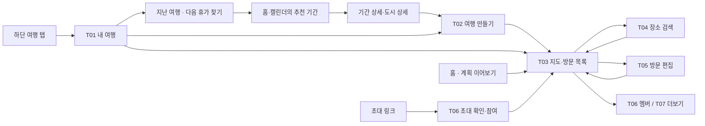

# 여행 플래너 디자인 명세

버전 1.1 · 작성 2026. 11. 13. · 코드 대조 2026. 11. 22. (`develop-mobile`의 `fe856357`) · 대상 Android·iOS

이 문서는 [오구리 디자인 시스템](../guide/DESIGN.md)을 상속해 [여행 계획 통합 명세](./TRAVEL_PLANNER_SPEC.md)를 화면으로 구체화한다. 여행 플래너의 정보 위계, 화면 구성, 컴포넌트, 상태와 조작을 정의한다. 기능·권한·저장 정책의 원문은 통합 명세다.

화면 설명은 현재 앱 코드를 기준으로 한다. 예시 배치와 정적 대비 표는 조작과 디자인 검토에 사용한다. 실제 기기 검증 범위와 이전 실행 결과는 [검증 가이드](./TRAVEL_PLANNER_TESTING.md)에 있다.

<!-- design-md:section experience -->
## 1. Experience · 사용 경험

### 1.1 디자인의 중심

**마음에 든 여행을 열고, 가고 싶은 곳부터 담는다.**

오구리는 연차를 잘 쓰는 시기와 여행지를 발견하게 돕는다. 플래너는 그 선택을 실제 여행 준비로 이어 준다. 사용자가 계획을 관리해야 한다는 부담보다, 장소 몇 곳을 담고 다시 열기 편하다는 느낌을 받게 한다. 장소 하나만 담거나 날짜를 비워 두어도 유효한 계획이다.

| 결정 | 화면에 적용할 기준 | 유지할 사용자 가치 |
| --- | --- | --- |
| TD01 · 기존 흐름에서 시작 | 추천·도시 상세에서 도시와 기간을 전달한다. 하단 여행 탭에서 내 여행을 열 수 있다. | 다시 검색하거나 날짜를 입력하는 수고를 줄인다. |
| TD02 · 날짜와 장소에 집중 | 기본 편집 화면은 날짜, 지도, 방문 목록, 장소 추가로 구성한다. | 첫 화면에서 할 일을 바로 이해한다. |
| TD03 · 필요한 만큼 열기 | 시간·메모는 장소를, 멤버는 상단 버튼을 눌러 연다. | 쓰지 않는 기능이 계속 눈에 들어오지 않는다. |
| TD04 · 같은 계획을 두 방식으로 보기 | 지도와 목록이 같은 날짜·방문·순서를 공유한다. | 두 화면을 따로 관리하지 않는다. |
| TD05 · 조용히 이어 쓰기 | 저장 상태와 마지막 보던 날짜를 유지한다. 변경 요약은 직접 열 때만 보여 준다. | 복귀할 때 설명이나 확인 절차를 반복하지 않는다. |
| TD06 · 회복할 수 있게 하기 | 오류·충돌은 영향을 받은 곳에서 설명하고 사용자의 입력을 보존한다. | 편집 결과를 잃을까 걱정하지 않는다. |

### 1.2 정보의 노출 단계

| 단계 | 노출하는 정보·행동 | 열리는 조건 |
| --- | --- | --- |
| 기본 | 여행명, 수정 시점, 날짜, 지도, 장소명·순서, 입력된 시각, 저장 상태, 장소 추가 | 여행을 열 때 |
| 방문 편집 | 시각, 공유 메모, 카테고리, 일차 이동, 외부 지도, 삭제 | 장소 행을 누를 때 |
| 함께 준비 | 멤버 목록, 초대·권한 안내 | 상단 `멤버`를 누를 때 |
| 여행 관리 | 여행 정보, 최근 변경, 참여 멤버, 나가기·삭제 | 상단 `더보기`를 누를 때 |
| 문제 해결 | 실패한 변경, 재시도, 최신 내용과 내 입력, 권한 종료 | 실제 문제가 생겼을 때 |

시간·메모의 빈 입력칸, 체크리스트, 완성률, 미확인 개수, 다음 할 일 배너는 기본 화면에 두지 않는다. 일정은 생성·초대가 끝나면 바로 연다. 정상 편집마다 성공 메시지를 반복하지 않는다.

### 1.3 기존 오구리와 연결



| 진입 위치 | 디자인 | 문맥·복귀 |
| --- | --- | --- |
| 도시 상세 | 도시 정보 뒤 `이 도시로 여행 만들기`. 기존 북마크와 별도 행동으로 구분 | 도시와 알고 있는 추천 기간을 T02에 채운다. 뒤로가면 원래 상세로 돌아간다. |
| 기간 상세 | 추천 도시 목록 아래 `이 기간으로 여행 만들기` | 추천 기간으로 시작하고 생성 화면에서 도시와 실제 날짜를 선택한다. |
| 여행 탭 | `내 여행`에서 예정·진행 중 여행, 접힌 지난 여행, 새 여행 추가를 제공한다. | 회원이 목록을 이용한다. 비회원은 여행 진입 안내와 로그인 버튼을 본다. |
| 홈 | 예정·진행 중 여행이 있으면 제목·기간·열기만 있는 이어보기 한 장 | 최고 연차 전략보다 낮은 위계. 여행이 없으면 빈 카드를 넣지 않는다. 대상 선정은 통합 명세 4.2절을 따른다. |
| 초대 링크 | 여행 제목·기간·선택한 도시 전체·초대한 사람과 `함께 계획하기` | 새 멤버는 명시적 참여 후 일정을 연다. 기존 멤버는 확인 대화상자 없이 상세로 이동한다. |

홈 이어보기는 여행 준비를 계속할 이유를 제공한다. 친구의 잦은 수정으로 카드가 교체되거나 배지가 늘어나지 않는다. 여행 중에는 현지 오늘을 쉽게 선택하고, 지난 여행은 다음 휴가 추천으로 이어진다. 이것이 리텐션을 위한 디자인 가설이며 실제 효과는 사용자 검증이 필요하다.

<!-- design-md:section foundations -->
## 2. Foundations · 색과 공간

### 2.1 색의 역할

여행 UI는 `OguriTheme.colors`와 기존 민트·중립 토큰을 사용한다. 아래는 대비 검토에 사용할 역할별 조합이다. 현재 주 버튼·제목 띠·방문 행 번호는 `colors.mint` 배경에 `travelAccentForeground`를 사용한다. 라이트 전경은 `textOnMint`, 다크 전경은 라이트 팔레트의 `textPrimary`다. 지도 핀의 전경은 라이트 팔레트의 `textOnMint`다. [Color.kt](../composeApp/src/commonMain/kotlin/com/bigong/oguri/core/designsystem/Color.kt) · [TravelPlannerComponents.kt](../composeApp/src/commonMain/kotlin/com/bigong/oguri/feature/travelplanner/ui/component/TravelPlannerComponents.kt) · [TravelMapScene.kt](../composeApp/src/commonMain/kotlin/com/bigong/oguri/feature/travelplanner/ui/model/TravelMapScene.kt)

| 역할 | 배경·전경 조합 | 보조 표현 |
| --- | --- | --- |
| 화면·목록 | `backgroundPrimary` / `textPrimary` | 큰 배경은 중립색으로 유지 |
| 편집 시트·행 | `surfaceCard` / `textPrimary` | 주소·저장 상태는 `textSecondary` |
| 선택한 날짜·방문 | `mintContainer` / `textPrimary` | 날짜는 굵기·선택 표시, 방문은 외곽선·선택 의미도 함께 제공 |
| 주 행동 | `mintContainer` / `textPrimary` | `textSecondary` 경계로 배경과 구분. 같은 화면에서 가장 뚜렷한 행동 하나에 사용 |
| 보조 행동 | `surfaceCard` / `textSecondary` | 글자·아이콘·위치로 행동을 구분 |
| 일반 핀 | 불투명한 `surfaceCard` / `textPrimary` | 지도와 구별되는 `textSecondary` 외곽선. 목록과 같은 번호 표시 |
| 선택 핀 | 불투명한 `mintContainer` / `textPrimary` | 선택 외곽선과 전면 배치. 색만으로 구분하지 않음 |
| 방문 순서 연결선 | `textSecondary` 선과 `surfaceCard` 받침 | 실제 지도 위 판독성 검증 필요. 날짜별 무지개 팔레트를 추가하지 않음 |
| 안내·휴일 | 기존 `orangeContainer`와 `textPrimary` | 연차·휴일 등 기존 의미를 이어 쓴다. 지도와 모든 날짜를 주황으로 강조하지 않음 |
| 실패·주의 | 본문은 `textPrimary`, 상태 아이콘은 `error`·`warning` | 아이콘과 구체적인 문장을 함께 사용. 색을 읽지 못해도 문제를 이해할 수 있게 함 |

민트·주황 위 흰 글자의 정적 대비는 상위 문서의 계산표에서 확인한다. 현재 라이트 테마의 버튼·제목 띠와 지도 핀의 실제 표면은 별도로 검증한다.

### 2.2 정적 대비 점검

상위 팔레트의 불투명 sRGB 값으로 계산했다. 일반 텍스트의 비교 기준은 [WCAG 2.2의 4.5:1](https://www.w3.org/WAI/WCAG22/Understanding/contrast-minimum.html)이다. 표는 토큰 조합 확인이며 실제 지도·투명도·시스템 컨트롤·포커스의 검증 결과가 아니다.

| 전경 / 배경 | 라이트 | 다크 | 용도 |
| --- | --- | --- | --- |
| `textPrimary` / `mintContainer` | 16.13:1 | 12.32:1 | 주 행동·선택 상태 |
| `textSecondary` / `mintContainer` | 9.36:1 | 9.47:1 | 주 행동 경계·보조 정보 |
| `textPrimary` / `surfaceCard` | 17.85:1 | 16.19:1 | 장소명·편집 본문·핀 번호 |
| `textSecondary` / `surfaceCard` | 10.35:1 | 12.44:1 | 주소·수정 시점·경계 |

지도 위 핀·선은 불투명한 받침을 사용하고 밝은 도로·어두운 도로·위성 배경에서도 별도로 확인한다. 필수 경계·포커스·아이콘은 인접 배경과의 대비도 확인해야 한다. 계산한 글자 대비만으로 지도 전체의 접근성을 통과 처리하지 않는다.

### 2.3 간격·모서리·깊이

| 대상 | 적용할 기준 | 근거·제한 |
| --- | --- | --- |
| T01·T02의 본문 | 좌우 20dp, 구역 간 24dp, 구역 안 12dp를 기본으로 검토 | 홈에서 확인한 값의 재사용 제안. 앱 전체의 공식 간격 척도로 선언하지 않음 |
| 입력 | `LabeledTextField`의 높이 48dp·반경 8dp·선 1dp·라벨 간격 8dp | 현재 공용 컴포넌트. 큰 글자에서 내용 높이가 필요하면 확장 |
| 기존 카드 | `PlaceCard`를 사용하는 곳은 현재 반경 8dp 유지 | 도시 카드의 사진·전체 구조를 방문 행에 복제하지 않음 |
| 확인 대화상자 | `ConfirmAlertDialog`의 현재 반경 8dp·화면 좌우 16dp·내부 20×24dp | 전체 삭제·기간 변경 등 영향 확인에 사용 |
| 방문 목록 | 하나의 연속 목록과 행 내부 여백으로 구분 | 행마다 그림자 카드·사진·장식 테두리를 반복하지 않음 |
| 여행 버튼·시트 | 주 버튼의 최소 높이 45dp, 장소 추가·편집 시트 상단 모서리 8dp | 화면별 사용 영역과 실제 접근성 조작 크기는 기기에서 확인 |
| 깊이 | 시트·대화상자 등 겹침 관계를 설명할 때만 기존 elevation 사용 | 목록 행에 입체감을 반복하지 않음. 다크 테마의 기존 처리 유지 |

지도는 본문 좌우 여백과 별개로 화면 폭을 활용한다. 목록·검색·편집에서는 읽기 영역의 여백을 유지한다. 시스템 안전 영역, 키보드, Google 출처 표시는 콘텐츠 여백과 별도로 확보한다.

<!-- design-md:section typography-assets -->
## 3. Typography & Assets · 글자와 자산

### 3.1 글자 위계

Pretendard와 `OguriTheme.typography`를 그대로 사용한다. 아래 크기·굵기·행간은 [Typography.kt](../composeApp/src/commonMain/kotlin/com/bigong/oguri/core/designsystem/Typography.kt)의 기존 역할이다. 자간은 상위 문서와 실제 역할 정의를 따르고 별도 보정값을 만들지 않는다.

| 화면 요소 | 기존 역할 | 크기 / 굵기 / 행간 |
| --- | --- | --- |
| 내 여행·여행 만들기 제목 | `sectionTitle` | 22sp / 700 / 30sp |
| 플래너 상단 여행명·편집 제목 | `cardTitle` | 18sp / 600 / 25sp |
| 장소명·입력 내용·공유 메모 | `bodyLarge` | 16sp / 400 / 24sp |
| 날짜 설명·주소·안내 문장 | `bodyMedium` | 14sp / 400 / 21sp |
| 날짜 선택·주 행동·적용·재시도 | `labelLarge` | 14sp / 600 / 20sp |
| 수정 시점·저장 상태 | `bodySmall` | 13sp / 400 / 19sp |
| 중요하지 않은 보조 표기 | `caption` | 12sp / 400 / 16sp |

주 행동·장소명·오류 해결 행동을 caption으로 축소하지 않는다. 공간이 부족하면 버튼을 다음 줄로 옮기거나 내용을 세로로 쌓는다. 여행명·장소명은 필요한 줄을 허용하고, 목록에서 생략한 전체 이름은 편집 화면과 접근성 이름으로 확인할 수 있게 한다. 날짜의 연도·일차는 의미가 바뀌는 임의 축약을 하지 않는다.

### 3.2 자산과 표현

- 멤버·더보기·날짜·순서 변경은 `ic_travel_*` 등 여행 전용 아이콘을 사용한다. 검색 결과의 여러 색으로 구성된 선택 표시는 원래 색을 유지한다.
- 캐릭터는 T01 첫 빈 상태에 기존 `img_oguri_empty.png` 등을 제한적으로 사용한다. T03의 빈 날짜는 짧은 안내와 장소 추가로 충분하다. 모든 실패·날짜마다 캐릭터를 반복하지 않는다.
- 여행 표지는 필수가 아니다. 검색 결과와 방문 목록에는 사진·평점·리뷰를 기본으로 넣지 않는다. 직접 추가한 장소도 같은 목록 위계로 다룬다.
- 핀 번호와 연결선은 기능 표시다. 별도 일러스트·배경 패턴·그라데이션을 추가하지 않는다. 실제 장소·Google 출처는 공급자의 표시 규칙을 따른다.

<!-- design-md:section components-states -->
## 4. Components & States · 컴포넌트와 상태

### 4.1 화면을 구성하는 단위

아래 이름은 디자인 문서에서의 역할 이름이다. Kotlin 클래스·모듈 구조를 확정하는 지시가 아니다.

| 역할 | 내용·행동 | 기본 표시 |
| --- | --- | --- |
| 여행 이어보기 | 여행명·실제 기간·계획 열기 | 홈의 보조 영역, 최대 한 여행 |
| 여행 요약 행 | 여행명·도시·연도가 있는 기간·필요한 멤버 정보 | T01. 행 전체로 여행 열기, 관리는 별도 메뉴 |
| 플래너 상단 | 뒤로·여행명·멤버·더보기, 수정 시점 | T03. 인원 배지·미확인 개수 대신 의미가 분명한 버튼 |
| 날짜 선택 | 가로 일차 칩과 오른쪽에 고정된 `전체 일정` | 지도·목록이 같은 일차를 사용 |
| 지도와 방문 표시 | 방문 핀, 순서 점선과 직선거리, 선택 강조, 지도 접기·펼치기 | 현재 일차 칩을 다시 누르면 지도 범위를 다시 맞춤 |
| 방문 목록 | 순서 번호·장소명·입력한 시각·메모가 있을 때 표시·이동 손잡이 | 같은 시각·메모의 빈 자리나 여러 행동 아이콘을 반복하지 않음 |
| 목록 상태와 장소 추가 | 일차·날짜·저장 상태, `장소 추가` | 목록을 확장해도 날짜와 추가에 접근 가능 |
| 장소 결과 행 | 이름·주소·선택, 추가 상태 | 선택한 장소의 미리보기와 날짜를 밝힌 추가 행동 |
| 방문 편집 시트 | 시각·메모·카테고리·일차·외부 지도·삭제·적용 | 장소 행을 누를 때 열림 |
| 변경 보기 | 변경된 날짜·장소·내용의 요약과 해당 위치 열기 | 수정 시점 또는 더보기에서 직접 열림 |
| 멤버·초대 | 참여자·역할·초대 링크·참여 안내 | 멤버 버튼 또는 외부 초대 진입 |
| 문제 해결 영역 | 실패한 변경·입력 보존·재시도·충돌 해결 | 영향을 받은 목록·편집 화면 안에 노출 |

방문 행은 순서를 바꿀 수 있는 경우 `위로 이동`·`아래로 이동` 접근성 동작을 제공한다. 방문 순서를 바꿀 때는 손잡이를 길게 눌러 드래그할 수도 있다.

### 4.2 공통 상호작용 상태

| 상태 | 표현·행동 |
| --- | --- |
| 기본 | 행동 이름을 읽을 수 있게 표시. 선택하지 않은 항목을 비활성처럼 흐리게 만들지 않음 |
| 눌림 | 기존 공용 컴포넌트의 눌림 피드백 유지. 선택 상태와 구별 |
| 선택 | 날짜는 배경·굵기·선택 표시, 방문은 핀·행 강조를 함께 변경. 접근성 선택 상태도 제공 |
| 포커스 | 키보드·보조기기의 현재 항목을 보이게 표시. 시트·메뉴를 닫으면 열었던 항목으로 복귀 |
| 사용 불가 | 이유를 가까이 설명. 권한 없는 관리 기능은 메뉴에서 제외하고, 일시적으로 불가능한 행동은 상태를 설명 |
| 처리 중 | 중복 실행만 막고 해당 행동에 진행 상태 표시. 전체 화면을 매번 잠그지 않음 |
| 실패 | 실패한 행동과 재시도 위치를 표시. 입력·다른 날짜·기존 장소는 유지 |
| 완료 | 실제 저장 상태·결과 행으로 피드백. 반복 완료 팝업·자동 화면 전환 없음 |

모바일에 hover를 필수 상태로 만들지 않는다. 포인터를 지원하는 환경에서는 같은 컴포넌트의 피드백을 제공하되 hover가 있어야만 기능을 찾을 수 있게 하지 않는다. `noRippleClickable`을 사용하더라도 눌림·포커스·접근성 의미는 검증한다.

### 4.3 저장·오류·충돌

| 상황 | 디자인 처리 | 피할 처리 |
| --- | --- | --- |
| 자동 저장 중 | 목록 제목 옆 고정 상태 영역에 `저장 중` | 매번 스낵바·스피너로 지도를 가림 |
| 서버 저장 확인 | 같은 영역을 `저장됨`으로 변경 | 로컬 반영만으로 저장 완료라고 표시 |
| 저장 실패 | `저장하지 못했어요`와 `다시 시도`, 아직 저장되지 않은 변경 식별 | 입력 초기화, 정상 날짜까지 전체 오류로 전환 |
| 연결 끊김 | 사용자 작성 내용은 유지. `오프라인 · 변경 내용은 아직 저장되지 않았어요` | 전체 지도를 내려받았거나 모든 외부 장소 정보를 보관했다고 약속 |
| 지도만 실패 | 지도 영역에 재시도. 날짜·목록·편집·직접 추가 유지 | 화면 전체를 오류 캐릭터로 대체 |
| 검색 실패 | 결과 영역에 재시도·직접 추가 | 결과 없음과 같은 문구 사용 |
| 동시 수정 충돌 | 최신 내용과 내 입력을 구분하는 해결 화면. 선택 후 실제 반영 상태 표시 | 내 입력 자동 삭제, 여행 전체를 내 버전으로 덮어쓰기 |
| 편집 중 대상 삭제 | 입력을 보존하고 삭제 사실·가능한 다음 행동 설명 | 삭제한 방문을 몰래 다시 생성 |
| 권한 종료 | 편집을 중단하고 이유·내 여행으로 돌아가기 제공 | 캐시가 있다는 이유로 계속 일정을 노출·편집 |

최근 변경이 도착해도 사용자가 읽는 행·지도 중심·편집 포커스를 빼앗지 않는다. 읽기 목록은 최신 상태를 반영하되 입력 중인 항목은 충돌 규칙으로 보호한다. 실패·충돌은 단순히 최근 수정 시점만 바꾸고 숨기지 않는다.

### 4.4 되돌리기와 파괴적 행동

본인의 방금 수행한 삭제·날짜 이동에는 목록 안의 메시지와 `되돌리기`를 제공한다. 자동으로 사라지는 메시지만이 유일한 회복 경로가 되지 않게 한다. 다음 본인 편집·화면 이탈 등으로 대상이 바뀌면 복구 가능 여부를 다시 판단하고, 타인의 후속 변경이 있으면 그대로 되돌려 덮어쓰지 않는다.

현재 [OguriSnackBar.kt](../composeApp/src/commonMain/kotlin/com/bigong/oguri/core/ui/component/OguriSnackBar.kt)는 행동 버튼을 렌더링하지 않는다. 되돌리기를 기존 스낵바가 지원한다고 가정하지 않는다. 우선 위의 목록 내 행동으로 설계하고, 공용 스낵바를 확장할 경우 키보드 포커스·스크린리더·유효 기간을 함께 검증한다.

여행 전체 삭제·멤버 제외·초대 링크 철회·소유권 변경에는 결과를 구체적으로 확인한다. 장소의 일반 편집에는 확인 팝업을 반복하지 않는다. 기간 단축·도시 변경은 변경될 내용을 먼저 보여 주며 범위 밖 방문을 삭제하지 않는다.

<!-- design-md:section layout-platforms -->
## 5. Layout & Platforms · 화면 설계

와이어프레임은 배치와 위계 설명용이다. 예시 도시·날짜·장소는 실제 추천 결과가 아니다. 선·공백의 비율은 실제 높이·폭·반경을 지정하지 않는다.

### 5.1 T01 · 내 여행

- 여행 탭의 제목은 `내 여행`이다. 예정·진행 중 여행을 먼저 보여 주고 `지난 여행`은 접힌 구역에서 연다. 내 여행과 참여 여행을 같은 목록에 표시한다.
- 여행 카드에는 제목, 선택한 도시 전체, 연도를 포함한 기간과 멤버 정보를 표시한다. 카드를 누르면 상세를 연다. 여행 관리는 상세의 더보기에서 연다.
- 여행 탭의 비회원 안내와 정상 조회 상태에는 하단 배너를 두며, 하단 탐색 및 시스템 영역만큼 여백을 확보한다.
- 여행이 없을 때만 빈 상태와 주 행동 `여행 만들기`를 둔다. 여행이 있으면 목록을 우선하고 새 여행 행동을 보조 위치로 유지한다. 비회원 안내·빈 목록·불러오기 실패를 같은 화면으로 처리하지 않는다.
- 지난 여행을 열면 기존 계획을 그대로 볼 수 있다. `다음 휴가 찾기`는 현재 개인 연차의 캘린더로 이동하며 새 여행 생성을 강요하지 않는다.

### 5.2 T02 · 여행 만들기

```text
뒤로  여행 만들기

여행 도시                    [오사카] [+ 도시 추가]
출발일 · 종료일              [날짜 선택 >]
추천받은 기간에서 실제로 떠나는 날짜를 골라요.

여행 이름                    [오사카 여행]
현지 시각 기준               오사카 · 시간대 확인

                         [여행 만들기]
```

도시와 실제 시작일·종료일이 주요 입력이다. 도시를 최대 10개까지 고를 수 있고 첫 도시가 기준 시간대를 정한다. 추천 날짜는 바꿀 수 있다. 제목을 비우면 도시 기반 기본 제목을 사용한다.

연차·멤버·표지·알림을 입력 구역으로 추가하지 않는다. 종료일이 시작일보다 빠른 경우 해당 날짜 가까이 안내한다. 비회원에게는 입력 화면 대신 로그인 안내를 표시한다. 로그인·가입 후 추천 도시·기간을 이어받아 입력 화면을 열며, 취소하면 회원 전용 안내에 머문다. 중복 탭·응답 대기 중 재시도로 여행이 중복 생성되지 않게 버튼 상태를 연결한다.

### 5.3 T03 · 지도와 방문 목록

```text
뒤로  오사카 여행                         멤버  더보기
최근 수정 10분 전  >

[1일차 4/10] [2일차 4/11 선택] […]      [전체 일정]
┌────────────────────────────────────────────────┐
│                지도                            │
│       ① ····· ② ····· ③                       │
│                                  [지도 접기]    │
│  Google 로고·출처 표시를 위한 노출 영역         │
└────────────────────────────────────────────────┘
2일차 · 4월 11일                              저장됨
①  방문 장소 A                               이동
②  방문 장소 B       14:00                    이동
③  방문 장소 C       메모 표시                이동

                         [+ 장소 추가]
```

`이동`은 드래그 손잡이의 설명이며 각 행에 길찾기 버튼을 놓는 뜻이 아니다. 메모 표시는 메모가 있을 때만 보이고 내용은 T05에서 연다. 수정 시점은 최근 변경으로 들어가는 보조 행동이며 배지나 자동 요약 팝업을 붙이지 않는다.

T03은 하단 탭 없이 여는 상세 화면이다. 지도를 펼친 상태로 시작하고 320:200 비율을 가용 높이에 맞춰 적용한다. 지도 접기·펼치기 버튼으로 목록 공간을 조절하며 같은 일차·방문 선택을 유지한다. 좁은 높이나 큰 글자에서 목록과 장소 추가의 조작 공간을 먼저 확보한다.

여행 탭·상세·초대에는 앱의 공통 App Open 전환 조건이 적용된다. 여행 전용 로그인과 온보딩은 광고 전환에서 제외한다. [모바일 광고 정책](../guide/MOBILE_CONVENTIONS.md#광고-정책)

**지도·목록의 연결 규칙**

1. 행을 누르면 같은 방문 핀을 강조하고 T05를 연다. 핀을 누르면 행을 선택해 보이는 곳으로 이동하며 편집 시트를 자동으로 열지 않는다.
2. 방문 순서는 행 손잡이를 길게 누르고 끌어 바꾼다. 행을 가로로 밀면 삭제 버튼이 나타난다. 스크롤은 목록, 이동·확대는 지도 영역이 맡는다.
3. 방문 순서를 바꾸면 목록 번호·핀 번호·연결선이 함께 바뀐다. 입력 시각은 유지하며 자동 시간 정렬을 하지 않는다. 같은 장소의 여러 방문은 각각 구분한다.
4. 현재 일차 칩을 다시 누르면 그 일차에 맞춰 지도 범위를 다시 잡는다. 빈 일차에서는 이전 일차의 조회 가능한 장소를 범위 계산에 참고하고, 참고 좌표가 없으면 기준 도시 중심으로 표시한다.
5. 좌표가 없는 방문은 목록에 남고 해당 구간의 선은 끊긴다.
6. 전체 일정 지도는 일차별 핀과 방문 목록을 표시한다. 연결선은 일별 지도에서만 표시한다. 전체 일정에서 추가할 때는 일차를 먼저 고른다.
7. 같은 좌표의 여러 방문은 번호를 합쳐 하나의 방문으로 만들지 않는다. 겹친 핀을 선택하면 해당 위치의 방문 선택 목록을 제공해 일차·순서를 구분한다.
8. 일별 지도와 목록의 연결선에는 두 장소 사이의 직선거리를 표시한다. 실제 이동 경로는 방문 정보의 외부 지도에서 확인한다.

일차 칩은 가로로 스크롤하고 선택한 일차가 보이도록 맞춘다. `전체 일정`은 오른쪽에 고정한다. 좁은 화면과 큰 글자에서도 두 조작이 계속 가능한지 검증한다.

### 5.4 T04 · 장소 검색과 추가

```text
닫기  장소 추가 · 2일차
[장소 이름 검색                       ]
검색 기준: 선택한 여행 도시

장소 이름 A
주소·지역                         선택 상태
장소 이름 B
주소·지역

Google Maps 출처 · 메모 · 카테고리
               [2일차에 추가]
                직접 추가
```

검색 결과는 이름·주소와 공급자 출처를 보여 준다. 여러 도시를 고른 여행에서는 도시 칩으로 검색 기준을 바꾼다. 결과 영역은 독립적으로 스크롤하며 검색 또는 직접 추가에서 메모·카테고리를 입력할 수 있다.

추가 버튼에는 대상 일차를 표시한다. 전체 일정에서 시작하면 일차를 먼저 고르고, 저장에 성공하면 해당 일차의 일정으로 돌아간다. 결과 없음은 검색어 수정·직접 추가로, 실패는 재시도·직접 추가로 연결한다.

### 5.5 T05 · 방문 항목 편집

```text
닫기  방문 장소 이름
2일차 · 여행지 현지 시각

방문 시각                    [선택 안 함 >]
메모                         [입력 영역]
메모는 이 여행의 멤버에게 보여요.
방문 날짜                    [2일차 >]

카테고리                     [선택 안 함 >]
외부 지도에서 길찾기
방문 삭제
                                  [적용]
```

시간·메모·날짜 이동은 `적용`으로 함께 확정한다. 목록에는 저장된 시각만 보이고 빈 시각을 계속 채우도록 유도하지 않는다. 시각과 순서가 어긋날 때만 편집 맥락에서 짧게 안내하고 자동 재정렬하지 않는다.

순서 변경은 목록에서 처리한다. 편집 시트의 본문은 세로로 스크롤하고, 키보드 밖의 영역을 누르면 입력을 닫는다. 키보드와 큰 글자 환경에서 편집 내용과 적용 버튼에 접근할 수 있는지 확인한다.

수정한 내용이 있는 상태에서 닫으면 한 번만 `계속 편집`·`수정 취소`를 선택할 수 있게 한다. 외부 지도는 선택한 Google 장소에 대해 열고 편집 초안은 복귀할 때 보존한다. 삭제를 선택한 경우 미적용 내용의 처리와 삭제 대상을 확인할 수 있게 하며 해당 방문만 삭제한다. 직접 추가한 장소만 사용자 작성 이름·위치를 수정할 수 있다.

### 5.6 T06 · 멤버와 초대

| 상태 | 위계·행동 |
| --- | --- |
| 멤버 목록 | 제목 → 소유자·멤버 목록 → 소유자의 `링크 공유하기`. 역할을 작게 명시하되 경쟁·기여 점수는 없음 |
| 공유 전 | `참여한 사람은 함께 일정을 수정할 수 있어요.` 링크 공유 범위를 알리고 시스템 공유 화면 사용 |
| 초대 확인 | 제목·선택 도시 전체·기간·초대한 사람 → 권한 안내 → `함께 계획하기`. 방문 목록·메모는 참여 후 표시 |
| 로그인 필요 | 참여 의도를 유지하고 로그인·필수 가입 후 같은 초대 확인으로 복귀 |
| 이미 참여 | 참여 대화상자 없이 여행 상세로 이동 |
| 만료·철회 | 참여 불가 이유와 `새 초대 링크를 요청해 주세요.` 기존 링크로 자동 재참여하지 않음 |
| 앱 미설치 | 초대 안내와 설치 경로. 자동 복귀가 되지 않으면 받은 링크를 다시 열도록 안내 |

멤버 제외·링크 철회는 소유자만 접근하는 관리 영역으로 둔다. 소유권 이전은 수락 상태를 구분한다. 멤버에게 숨긴 관리 버튼의 자리를 빈 버튼으로 남기지 않는다. 여행을 만든 직후 자동으로 이 화면을 열지 않는다.

### 5.7 T07 · 여행 더보기와 최근 변경

`여행 정보`·`최근 변경`·참여 멤버와 여행 나가기·삭제를 관리 화면에 둔다. 소유자·멤버에 따라 가능한 행동만 표시한다. 기간 단축 미리보기는 새 마지막 날 뒤로 옮길 방문을 알려 준다. 여행 정보의 `처음 추천받은 기간`은 월·일을 표시하고 원래 추천을 여는 버튼을 제공한다.

최근 변경은 수정 시점 또는 이 메뉴에서 직접 연다. 날짜·장소·무엇이 달라졌는지를 먼저 보여 주고 누르면 해당 일차의 현재 계획으로 이동한다. 자동 열림·읽음 강요·미확인 개수는 없다. 대상이 삭제·이동되었으면 현재 상태를 설명한다. 타인의 편집 하나마다 별도 카드나 알림을 만들지 않는다.

현재 관리 화면에서 `내 알림`을 제거했다. 남아 있는 서버 API의 동작은 [검증 가이드](./TRAVEL_PLANNER_TESTING.md#출발-전-알림의-현재-상태)를 따른다.

### 5.8 플랫폼·접근성·복귀

- 이 기능의 조작 영역은 Android 최소 48×48dp, iOS 최소 44×44pt를 제품 기준으로 삼는다. 아이콘 그림 크기와 누를 수 있는 영역은 별개다. 멤버·더보기·날짜·수정 시점·이동 손잡이·지도 제어도 실제 영역을 확인한다.
- 읽기 순서는 여행명 → 날짜 → 목록·지도 전환 → 해당 날짜 방문 → 장소 추가가 이해되게 한다. 핀만이 장소를 찾는 유일한 경로가 되지 않게 하고, 지도 탐색의 반복 초점이 목록 조작을 방해하면 목록 모드로 건너뛸 수 있게 한다.
- 스크린리더에는 예를 들어 `2번째 방문, 장소 이름, 14시, 메모 있음`을 전달한다. 순서 변경 후 새 순서를 한 번 안내하고, 자동 저장 완료·타인의 변경을 계속 낭독하지 않는다. 실패·권한 종료는 인지할 수 있게 안내한다.
- 뒤로가기는 열린 선택기 → 편집·검색·메뉴 → 여행 → 원래 진입 화면 순서로 처리한다. 편집 초안이 있으면 위의 취소 규칙을 우선한다. 외부 링크로 시작해 이전 화면이 없으면 내 여행으로 돌아간다.
- 일반 재진입은 마지막 유효 날짜를 복원한다. 상태가 없으면 여행 전·후에는 1일차, 여행 중에는 현지 오늘을 연다. 사용자가 날짜·변경 대상을 명시한 진입은 마지막 보기보다 우선한다. 검색·외부 지도·로그인 복귀는 원래 과업을 이어 간다.
- 초기 화면에서 핀·지도 제어·Google 출처·장소 추가가 겹치지 않는지 확인한다. 모달 편집 시트의 포커스 제한과 종료 후 원래 행 복귀도 검증한다.
- 일반 화면 이동은 공통 페이드 전환을 사용한다. 모션 감소 설정에서도 선택·순서 변화를 이해할 수 있어야 한다.

모바일 기본 검증 폭은 Android 320·390dp와 이에 대응하는 iOS의 실제 논리 폭이다. 큰 글자와 가로 화면도 별도로 확인한다. dp·sp·pt·CSS px를 같은 단위로 취급하지 않는다. 웹 플래너의 열 구성·반응형 규칙은 이번 문서에서 확정하지 않는다.

Google 지도 로고·출처는 지도 시트에 가리지 않고 공급자 SDK에서 허용하는 방식으로 노출 영역을 조정한다. 검색 결과·지도 밖 장소 정보에는 사용 API의 별도 출처 요구도 확인한다. [Google Maps SDK 정책](https://developers.google.com/maps/documentation/android-sdk/policies)을 기준으로 하며 iOS·Places의 해당 정책도 구현 시 각각 확인한다.

<!-- design-md:section content-locales -->
## 6. Content & Locales · 문구와 현지화

### 6.1 화면 문구 제안

| 위치·상황 | 문구 | 설계 의도 |
| --- | --- | --- |
| 홈 이어보기 | `계획 이어보기` | 다음 할 일을 지시하지 않음 |
| 첫 여행 없음 | `여행 만들기` | 빈 목록에서 바로 생성으로 이동 |
| 빈 날짜 | `가고 싶은 곳부터 담아볼까요?` / `장소 추가` | 비어 있음을 미완료로 평가하지 않음 |
| 전체 일정 | `전체 일정` | 여행 전체의 지도와 일차별 목록을 열기 |
| 장소 추가 | `2일차에 추가` | 결과와 대상 일차를 명시 |
| 저장 상태 | `저장 중` / `저장됨` / `저장하지 못했어요` | 확정 상태를 일치시킴 |
| 지도 실패 | `지도를 불러오지 못했어요. 목록은 계속 편집할 수 있어요.` / `다시 시도` | 가능한 과업을 설명 |
| 검색 실패 | `장소를 찾는 중 문제가 생겼어요.` / `다시 시도` / `직접 추가` | 결과 없음과 구별 |
| 공동 메모 | `함께 가는 멤버에게도 보여요` | 공유 범위를 입력 전에 안내 |
| 충돌 | `다른 사람이 이 항목을 수정했어요. 내 입력과 최신 내용을 확인해 주세요.` | 해결할 내용과 입력 보존을 설명 |
| 초대 | `함께 계획하기` | 링크 열기와 실제 참여를 구별 |
| 지난 여행 | `다음 휴가 찾기` | 기존 연차 추천으로 자연스럽게 연결 |

제목·버튼에는 마침표를 붙이지 않고 안내 문장은 해요체로 쓴다. `계획이 30% 완성됐어요`, `아직 할 일이 남았어요`, `친구를 초대하고 완성하세요`처럼 준비를 평가하거나 부담을 주는 문구는 쓰지 않는다.

### 6.2 날짜·언어·리소스

여행 기간은 추천 휴식 기간과 구별해 `실제 여행 날짜`로 설명한다. 여행지 현지 날짜·시각을 사용하고 언어·기기 시간대와 혼동하지 않는다. 서로 다른 연도의 여행이 섞인 목록에는 연도를 보여 준다. `1일차`와 실제 날짜를 함께 제공하며 긴 날짜는 줄바꿈·세로 배치로 처리한다.

모바일 노출 문자열은 기존 `composeResources`의 기본 영어·한국어·일본어·중국어 폴더에 같은 키로 관리한다. 현재 번역과 형식 인자는 각 언어의 `travel_planner.xml`에서 확인한다. 이름·주소·초대한 사람·날짜를 문장에 합칠 때 로캘별 순서와 줄 길이를 검증한다. 임의의 축약·작은 글자·아이콘만으로 맞추지 않는다.

<!-- design-md:section governance -->
## 7. Governance · 인수와 검증

### 7.1 문서의 우선순위와 인계 범위

사용자의 명시적 요구 → 저장소에서 확인한 사실 → 통합 기능 명세의 제품 정책 → 상위 DESIGN.md의 디자인 계약 → 이 기능의 화면 디자인 순서로 해석한다. 상위 디자인 계약의 접근성 문제를 그대로 복제하지 말라는 기준도 함께 적용한다. 내용이 충돌하면 충돌 지점을 기록하고 제품 정책·공용 디자인의 소유 범위에서 해결한다.

디자인 인계에서는 날짜·지도·방문 목록의 관계, 선택·저장·권한 상태, 로그인·외부 지도 복귀, 입력 보존을 확인한다. 공동 편집은 실제 다중 계정 실행으로 확인한다.

### 7.2 요구사항과 화면 대조

| 최초 요구 | 디자인 반영 위치 | 통합 명세 인수 기준 |
| --- | --- | --- |
| 여행 생성 | T02의 도시·실제 날짜·기본 제목, 로그인 복귀 | AC01–04 |
| Google 지도·검색·핀·연결선 | T03·T04, 같은 방문의 지도·목록 선택, 출처 영역 | AC07·15·18 |
| 추가·삭제·드래그 순서 편집 | T03 손잡이, T04 추가, T05 대체 조작·삭제·회복 | AC05–07·19 |
| 날짜·시각·메모 | 공통 날짜 선택과 T05 선택 입력 | AC08–09·14 |
| 친구 초대·함께 편집 | T06의 명시적 참여, 저장·충돌·권한 종료 상태 | AC10–12·16–17 |
| 기존 추천·연차 경험 연결 | 상세 생성, 여행 탭, 홈 이어보기, 다음 휴가 찾기 | AC01·13·21 |
| 가벼운 사용감·재방문 | 단계별 노출, 저장 상태, 보기 상태 복원 | AC04·08·12·22 |

### 7.3 디자인 점검에서 반영한 보완

| 점검 사례 | 발견할 수 있는 불편 | 이 문서의 처리 |
| --- | --- | --- |
| 장소 하나만 담고 종료 | 초대·안내·빈 시간 입력이 작업을 붙잡음 | 생성 직후 T03, 추가 정보는 직접 열 때만 표시 |
| 큰 글자로 2일차 편집 | 지도와 시트가 목록·날짜·추가를 가림 | 지도 접기, 목록 공간 확보, 편집 시트 세로 스크롤 |
| 지도 배경이 바뀜 | 핀·번호·점선을 구분하기 어려움 | 실제 지도와 핀 전경·배경의 대비를 확인 |
| 같은 카페를 두 번 방문 | 핀이 겹쳐 하나의 방문처럼 보임 | 방문별 식별 유지, 겹친 위치의 방문 선택 목록 |
| 삭제 후 회복 | 현재 스낵바에 되돌리기 버튼이 없음 | 목록 안의 명시적 되돌리기 행동으로 설계 |
| 친구가 계속 수정 | 화면·지도·홈 카드가 흔들리고 변경 확인을 강요 | 포커스·카메라 유지, 안정적인 이어보기 선정, 변경 보기는 직접 열기 |
| 며칠 뒤 복귀 | 일차와 맥락을 다시 찾아야 함 | 마지막 유효 날짜 복원, 명시적 진입 의도 우선 |
| 초대 참여·로그인 | 원래 여행을 잃고 연차 온보딩에서 멈춤 | 참여 문맥 복원, 필수 가입 후 초대 확인으로 복귀 |

위 점검은 시나리오를 문서와 대조한 결과다. 실제 사용자가 편하게 사용했다거나 리텐션이 개선되었다는 증거는 아니다.

### 7.4 실제 디자인·구현의 인수 조건

- T01–T07의 정상·빈 상태·로딩·부분 실패·권한 종료·저장 실패·충돌을 라이트·다크에서 확인한다. 배너와 하단 탐색이 콘텐츠를 가리지 않는지 확인한다.
- 320·390dp 수준의 좁은 화면, 큰 글자, 키보드, 가로 화면에서 날짜·장소 추가·적용·오류 해결에 접근할 수 있는지 확인한다. 긴 한국어·영어·일본어·중국어의 장소명과 기간도 사용한다.
- Android TalkBack·iOS VoiceOver와 키보드로 여행 생성, 검색, 날짜 이동, 위로·아래로, 초대, 충돌 해결을 수행한다. 드래그·지도·색만으로 가능한 행동이 없어야 한다.
- 지도 확대·이동, 목록 스크롤, 드래그, 시트 조절이 서로를 가로채지 않는지 확인한다. 목록 선택·핀 선택의 다른 결과와 카메라 복귀 규칙을 검증한다.
- 출처·키보드·시트·시스템 바·목록 회복 메시지가 서로의 주요 행동을 가리지 않는지 실제 화면에서 확인한다. 지도 로고·검색 결과의 출처도 포함한다.
- 실제 전경·배경·경계·포커스 대비를 측정한다. 정적 토큰 표와 런타임의 투명도·지도·플랫폼 기본 스타일이 다르면 화면 기준으로 보완한다.
- 타인의 동시 편집·대상 삭제·권한 철회·오프라인 재실행에서도 입력과 저장 상태가 정확한지 확인한다. 초대·로그인·외부 지도 왕복 후 날짜와 대상이 유지되어야 한다.
- 첫 장소 추가까지의 이해도, 다시 열었을 때 맥락을 찾는 수고, 불필요한 단계와 방해를 사용자 과업으로 확인한다. 리텐션은 통합 명세 14장의 의미 있는 행동·여행 준비 기간 기준으로 측정하고, 단순 실행·알림 클릭과 구분한다.

### 7.5 확정하지 않은 값과 검증 상태

| 항목 | 현재 상태·다음 확인 |
| --- | --- |
| 브랜드·글자·기존 치수 | 상위 DESIGN.md에서 상속. 기능별 색 조합은 정적 계산으로 확인 |
| 지도·시트·핀 | 현재 지도 비율과 접기 동작을 실제 화면 폭·글자 크기에서 검증 |
| 전환 | 공통 페이드와 시트 닫기 전환의 모션 감소 설정 검증 |
| Google 지도·Places 출처·정보 보관 | 사용하는 SDK·API별 정책과 실제 표시 검토 필요. 사용자 작성 내용과 외부 제공 정보를 구분 |
| 실행 화면의 대비·반응형·보조기기 | 미검증. 문서 검토·정적 계산으로 통과를 대신하지 않음 |
| 공동 편집 품질·리텐션 효과 | 배포 기기의 다중 계정 실행과 실제 과업·관찰 데이터로 검증 |

### 7.6 근거 자료

- [상위 디자인 시스템](../guide/DESIGN.md): 경험 원칙·토큰·타이포그래피·공용 컴포넌트·플랫폼 기준.
- [통합 기능 명세](./TRAVEL_PLANNER_SPEC.md): T01–T07, 진입·권한·날짜·저장·협업·알림·검증의 제품 정책.
- [기존 화면 구성](../guide/MVP_WIREFRAME.md), [모바일 규칙](../guide/MOBILE_CONVENTIONS.md), [프로젝트 구조](../guide/MOBILE_PROJECT_STRUCTURE.md): 기존 오구리 흐름과 구현 경계.
- [Compose 접근성 기본값](https://developer.android.com/develop/ui/compose/accessibility/api-defaults), [Apple 접근성](https://developer.apple.com/design/human-interface-guidelines/accessibility): 플랫폼별 조작 영역·큰 글자·접근성 기준.
- [WCAG 텍스트 대비](https://www.w3.org/WAI/WCAG22/Understanding/contrast-minimum.html), [Google Maps SDK 정책](https://developers.google.com/maps/documentation/android-sdk/policies): 대비 계산과 지도 출처 검토. 외부 자료 확인일: 2026. 11. 13.
